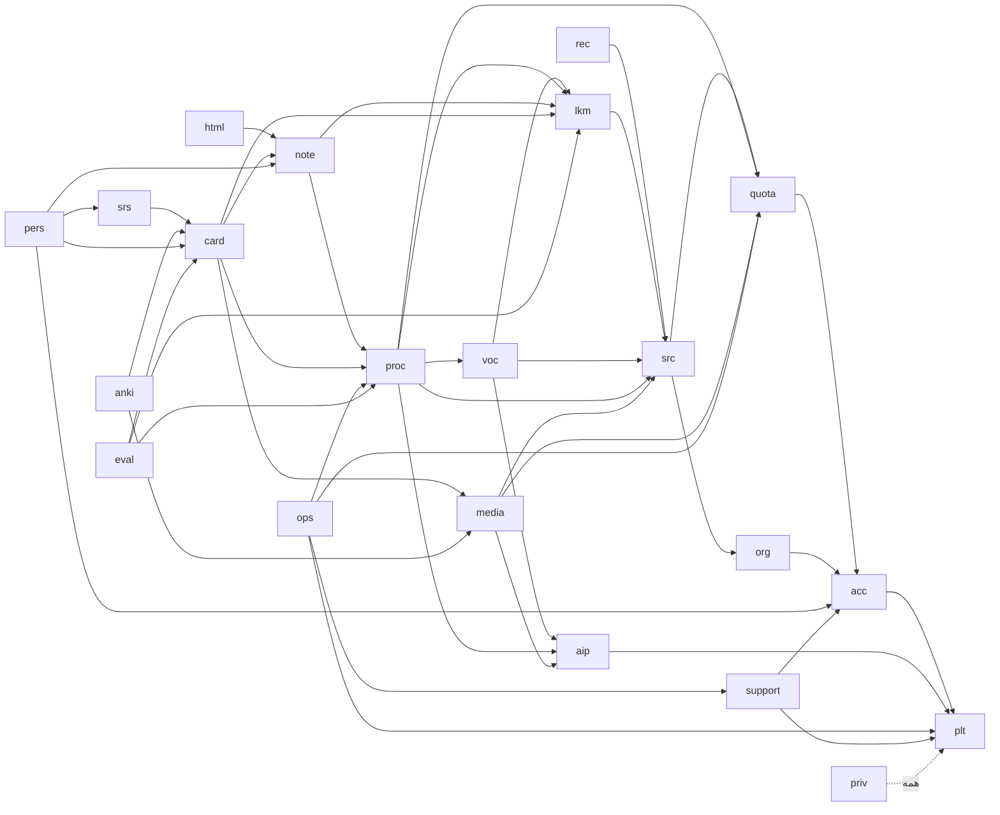
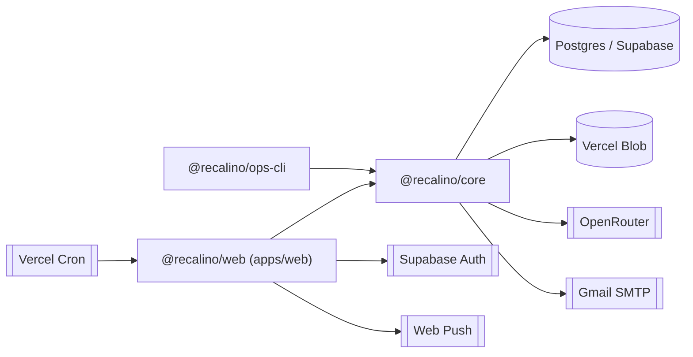

# Recalino — نمای کلی As-Is

- Task Card: `REC-1` · پایه: `a1d559b` · تاریخ: 2026-10-30
- برچسب‌ها: **[M]** = Observed by model (از مخزن خوانده شده)؛ **[NV]** = Not Verified. URL عمداً نیامده است (AC-8).
- **همهٔ دستورهای این سند خوانده شده‌اند و هیچ‌کدام اجرا نشده‌اند.**
- اصلاح کم‌ریسک `REC-5` (2026-10-31، پایه `a31cce4`): یافتهٔ F-5 از REC-1-review در این سند اعمال شد. فهرست اعمال‌شده و اعمال‌نشده در [risk-register.md بخش ۷](risk-register.md) است.

## ۱. محصول در یک پاراگراف

Recalino منابع هر جلسهٔ کلاس انگلیسی را به جزوهٔ مستند، کارت چندرسانه‌ای و مرور روزانهٔ FSRS تبدیل می‌کند. این منابع صوت ضبط‌شده، عکس تخته و PDF هستند. منبع حقیقت، مدل دانشی نسخه‌دار (LKM) است. زمان‌بندی مرور، سهمیه و دسترسی کد قطعی‌اند، نه خروجی LLM. وضعیت: MVP در پایلوت هشت‌نفره (D37). منبع: `README.md`، `CLAUDE.md`، `docs/PRODUCT_DECISIONS_LOG.md`. [M]

## ۲. Stack

| لایه | انتخاب و نسخه | شاهد | برچسب |
|---|---|---|---|
| Runtime | Node.js ‎`>=24 <25`‎ (`.nvmrc`)؛ pnpm `12.4.2` | `package.json` خط ۵ تا ۸ | [M] |
| زبان | TypeScript `6.0.3` | `package.json` | [M] |
| وب و API | Next.js `16.3.8` (App Router، build با `--webpack`)، React `19.3.0` | `apps/web/package.json` | [M] |
| میزبانی | Vercel، region `lhr1`؛ Cron دقیقه‌ای روی `/api/jobs/run` | ADR-0001، `apps/web/vercel.json` | [M]؛ تنظیم واقعی پروژه [NV] |
| دیتابیس و Auth | Supabase Free (Postgres و Auth)؛ ورود فقط با Google (`@supabase/ssr` `0.12.7`) | ADR-0001، ADR-0002 | [M] |
| دسترسی داده | Kysely `0.29.6` روی `pg` `8.23.1`؛ نوع‌ها با `kysely-codegen` در `packages/core/src/db/types.ts` | ADR-0002 | [M] |
| صف | جدول Postgres در schema `plt` با `FOR UPDATE SKIP LOCKED` | ADR-0003، `packages/core/src/plt/jobs.ts` | [M] |
| فایل | Vercel Blob خصوصی (`@vercel/blob` `2.8.0`)، فقط از `plt/storage-vercel-blob.ts` | `.dependency-cruiser.cjs` قاعدهٔ `storage-sdk-behind-the-layer` | [M] |
| اعتبارسنجی | zod `4.6.5` | `packages/core/package.json` | [M] |
| مرور | `ts-fsrs` `5.4.2` | `packages/core/package.json` | [M] |
| AI | OpenRouter؛ پیش‌فرض مخزن: `google/gemini-3.8-flash` (LLM)، `anthropic/claude-haiku-4.5` (Vision و اصلاح گفتاری) | `config/openrouter-defaults.json` خط ۳ تا ۵ | [M]؛ مقدار production [NV] |
| صوت و تصویر | `ffmpeg-static`، `sherpa-onnx-node` (صدا)، `sharp`، `@napi-rs/canvas`، `pdfjs-dist` | `apps/web/package.json` | [M] |
| اعلان و ایمیل | `web-push`؛ `nodemailer` (SMTP Gmail پایلوت، D42) | `apps/web/package.json`، `packages/core/package.json` | [M] |
| کیفیت | Biome `2.5.15`، dependency-cruiser `18.4.0`، Vitest `5.0.3`، Playwright `1.63.0`، `@axe-core/playwright` | `package.json` ریشه، `apps/web/package.json` | [M] |
| CI | GitHub Actions، `ubuntu-24.04`، actionها با SHA ثابت؛ Dependabot فقط امنیتی | `.github/workflows/ci.yml`، `.github/dependabot.yml` | [M] |

## ۳. ساختار مخزن

| مسیر | محتوا | تعداد فایل ردیابی‌شده |
|---|---|---|
| `apps/web/` | اپ Next.js | ۸۲۷ |
| ↳ `src/app/` | صفحه‌ها و route‌ها (۶۵ فایل `route.ts` زیر `api/`) | ۱۷۵ |
| ↳ `src/server/` | لایهٔ سرور اپ: routeها، preparerها، jobها، موتور صدا | ۲۱۵ |
| ↳ `src/ui/` | کامپوننت‌ها، متن‌ها، ضبط (ماژول REC) | ۳۴۶ |
| ↳ `e2e/` | آزمون‌های Playwright | ۵۶ |
| `packages/core/src/` | ۲۰ ماژول دامنه و دو پوشهٔ مشترک (`db`، `config`)؛ ماژول بیست‌ویکم، `rec`، فقط در capability map است (بخش ۴) | ۴۲۷ |
| `packages/ops-cli/` | ابزار اپراتور | — |
| `supabase/migrations/` | migrationهای SQL | ۵۶ |
| `tools/` | گاردها، ارزیابی، پشتیبان، صدا | ۱۲۹ |
| `docs/` | PRD، ADR، FR، runbook، طرح، ممیزی، معماری | ۲۰۰ |
| `artifacts/` | شواهد verification، تصویر و JSON | ۴۳۱ |

همهٔ شمارش‌ها با `git ls-files` گرفته شده‌اند. [M]

## ۴. ماژول‌ها

فهرست کامل ماژول‌ها، نقش و commit پیدایش در [history.md بخش ۳](history.md#۳-نقشهٔ-ماژولها) آمده است. خلاصه: `plt`، `acc`، `quota`، `org`، `src`، `aip`، `lkm`، `voc`، `proc`، `note`، `html`، `media`، `card`، `srs`، `anki`، `pers`، `priv`، `ops`، `support` و `eval` در `packages/core/src/`. ماژول `rec` فقط در capability map است و پیاده‌سازی‌اش در `apps/web/src/ui/recording/` قرار دارد. [M]

## ۵. نقشهٔ وابستگی

### ۵.۱ وابستگی ماژول‌ها (از `tools/capability-map.json`؛ پیکان یعنی «وابسته است به»)

قاعده‌های اجراشده در `pnpm check:boundaries` [M]:

- وابستگی گذرا مجاز است.
- `priv` به همهٔ ماژول‌ها دسترسی دارد.
- import میان ماژول‌ها فقط از راه `index.ts` (`module-public-api`).
- `db` و `config` حق import ماژول ندارند.
- `packages/core` حق import از `next` و `react` ندارد.
- چرخه ممنوع است.

### ۵.۲ وابستگی بسته‌ها

[M] از `package.json`ها و `apps/web/vercel.json`. اتصال واقعی هر سرویس در production: [NV].

## ۶. دستورهای build و test (خوانده‌شده، اجرانشده)

منبع: `package.json` ریشه و `apps/web/package.json`. [M]

| دستور | کار |
|---|---|
| `pnpm install` | نصب (Node 24، pnpm 12) |
| `pnpm lint` | `biome check .` |
| `pnpm typecheck` | `pnpm -r --if-present typecheck && tsc -p tools`؛ در web: `next typegen --webpack && tsc --noEmit` |
| `pnpm check:boundaries` | `depcruise apps packages tools --config .dependency-cruiser.cjs` |
| `pnpm test` / `test:unit` / `test:int` | `vitest run` (پروژه‌های `unit` و `integration`)؛ integration به `pnpm db:start` و Docker نیاز دارد |
| `pnpm test:e2e` | Playwright در `apps/web` (`playwright.config.ts`)؛ `test:smoke` با `e2e/smoke/playwright.config.ts` |
| `pnpm verify` | lint، typecheck، boundaries و test |
| `pnpm build` | build در web، به ترتیب این گام‌ها: `tools/legal/guard.ts`، `tools/schema-version/build.ts`، `tools/voice/prepare-build.mjs`، `check-native-runtime.mjs`، `next build --webpack`، trace native و صدا، `tools/function-size/check.ts` |
| `pnpm check:client-bundle` | نبودن اسرار در bundle مرورگر (FR-PLT-009) |
| `pnpm db:start` / `db:stop` / `db:reset` / `db:new` | Supabase CLI محلی |
| `pnpm db:types` | تولید نوع Kysely؛ CI عقب‌ماندن آن را با `git diff --exit-code` می‌گیرد |
| `pnpm db:apply` | اعمال migration روی ابر (پیش‌فرض dry run؛ `--apply` و `--approve-data-loss <version>`؛ D77) |
| `pnpm legal:build`، `pnpm schema:version` | تولید `texts.generated.ts` و `schema-version.generated.ts` |
| `pnpm ops` | ابزار اپراتور (`tsx src/main.ts`) |

**CI** (`.github/workflows/ci.yml`) [M]:

- **job `verify`:** این گام‌ها به ترتیب اجرا می‌شوند:
  1. `install --frozen-lockfile`
  2. `lint`، `typecheck`، `check:boundaries` و `test:unit`
  3. `node --test tools/auth/check-google.test.mjs`
  4. `db:start`، بعد `db:types` همراه با diff
  5. `test:int`
  6. `build` و `check:client-bundle`
  7. artifact برای e2e
- **job `e2e`:** فقط روی `main`، اجرای دستی یا PR با برچسب `e2e` اجرا می‌شود. از build همان job ‏`verify` استفاده می‌کند (D84).
- **paths-ignore:** تغییر فقط در `docs/plans`، `docs/adr`، `docs/fr`، `docs/ops`، `docs/audit`، `docs/*.md`، `artifacts` یا `*.md` CI را اجرا نمی‌کند. سند تازهٔ `docs/aeo/**` زیر هیچ‌کدام از این الگوها نیست، پس CI را اجرا می‌کند.

## ۷. محیط‌ها و مرز اعتماد (خلاصه)

- **Production:** Vercel و Supabase Free در London. اسرار پایلوت فقط در target Production هستند (D82). Preview فقط با fixture (`RECALINO_UI_PREVIEW=1`) کار می‌کند. اجرای این تنظیم‌ها با مالک است. [M]؛ وضعیت واقعی: [NV]
- **عامل کدنویسی:** `.claude/settings.json` اجرای `execute_sql`، `db push`، `pnpm db:apply` و `git push` را بی‌پرسش مجاز می‌کند. hook از نوع `PreToolUse` (`.claude/hooks/data-loss-guard.ts`) پیش از SQL مخرب و پیش از `--approve-data-loss` پرسش می‌کند (D81). [M]
- **پشتیبان:** dump رمزگذاری‌شدهٔ روزانه روی یک میزبان Windows با Task Scheduler (`tools/backup/`، `docs/runbooks/BACKUP_RESTORE.md`). [M]

## ۸. اسناد مرتبط موجود

- `docs/architecture/01` تا `05` (#75): inventory سیستم، معماری As-Is، جریان داده، ثبت ریسک (AR-01 تا AR-23) و پرسش‌های باز. این سند جای آن‌ها را نمی‌گیرد. تمرکز این سند تاریخچه و تصمیم‌هاست. [M]
- `docs/audit/2026-10-18-project-audit.md` و `docs/audit/2026-10-18-fix-tracker.md` (#73). [M]
