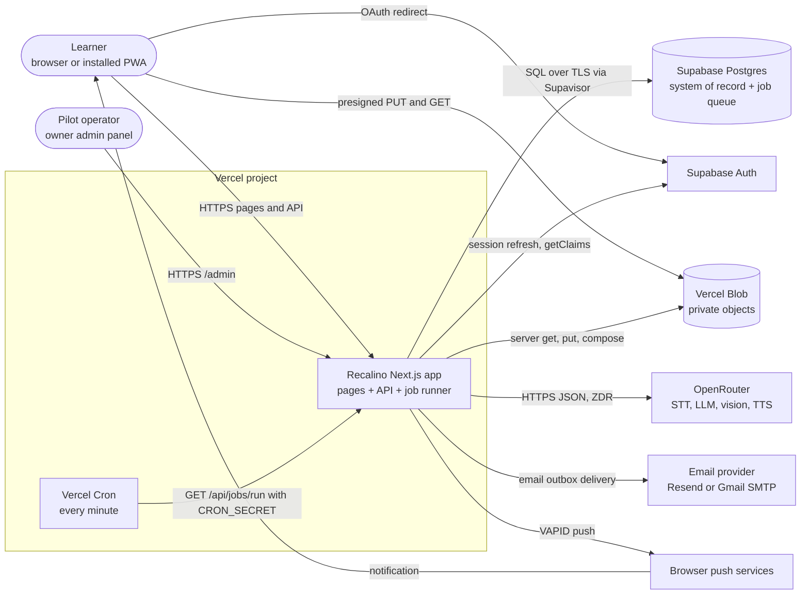
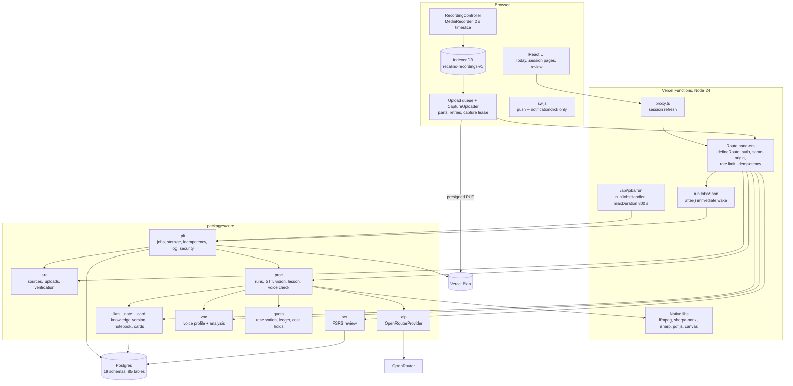
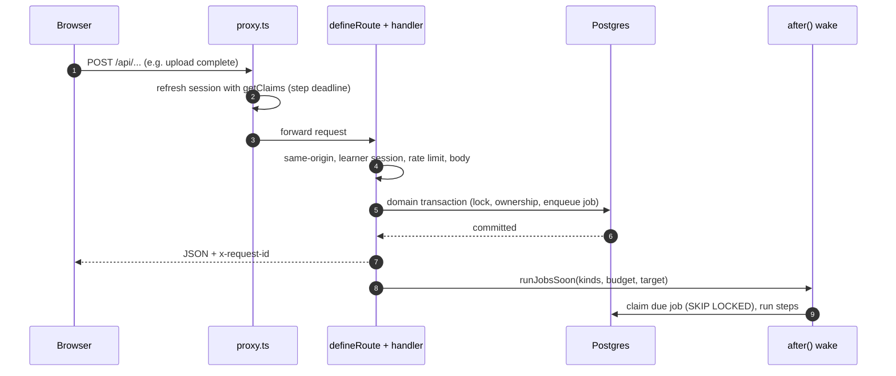
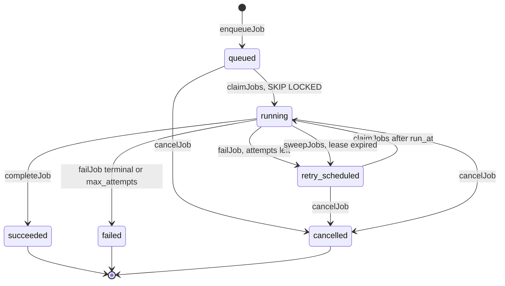

# ۰۲ — معماری فعلی (As-Is Architecture)

- **تاریخ:** 2026-10-21
- **مبنای کد:** commit `924735b` روی شاخهٔ `ccr-6c21ad01-nlxr08`
- **برچسب‌ها:** CONFIRMED / INFERRED / UNKNOWN. تعریف آن‌ها در [01](01-system-inventory.md) آمده است. مسیرها نسبت به ریشهٔ مخزن‌اند.

---

## ۱. خلاصهٔ معماری

| ویژگی | وضعیت فعلی | شاهد | برچسب |
|---|---|---|---|
| سبک | **Modular monolith**: یک واحد استقرار (Next.js روی Vercel) و پکیج دامنهٔ `@recalino/core` | `apps/web/next.config.ts:47` (`transpilePackages`)، `.dependency-cruiser.cjs:19` | CONFIRMED |
| منبع حقیقت | Postgres در Supabase. صف Job، کلید idempotency، رخداد ممیزی و رخداد امنیتی هم همین‌جا هستند | `supabase/migrations/20261002094004_plt_jobs.sql:4`، `packages/core/src/plt/` | CONFIRMED |
| پردازش سنگین | داخل همان Vercel Functions و بدون worker جدا: ffmpeg، sherpa-onnx، sharp، pdf.js و canvas | `apps/web/next.config.ts:63`، `:73` | CONFIRMED |
| هوش مصنوعی | تنها درگاه OpenRouter است. یک `AiProvider` با سه متد `structured`، `transcribe` و `speech` دارد | `packages/core/src/aip/contracts.ts:153`، `apps/web/src/server/ai.ts:5` | CONFIRMED |
| فایل‌ها | Vercel Blob خصوصی. مرورگر با presigned URL مستقیم می‌نویسد و می‌خواند | `packages/core/src/plt/storage.ts:154`، `packages/core/src/plt/storage-vercel-blob.ts:84` | CONFIRMED |
| وضعیت در UI | **polling**. Realtime، WebSocket و SSE نیست. Push فقط برای اعلان است | `apps/web/src/ui/workspace/automatic-learning-poll.ts:8`، `apps/web/public/sw.js:9` | CONFIRMED |
| زمان‌بندی کار پس‌زمینه | Cron هر دقیقه کار می‌کند و پس از پاسخ، `after()` کار را فوری بیدار می‌کند | `apps/web/vercel.json`، `apps/web/src/server/jobs.ts:227` | CONFIRMED |

---

## ۲. نمودار System Context

**توضیح:** همهٔ مرزهای بیرونی در نمودار آمده‌اند. سیستم هیچ مرز دیگری ندارد: نه worker، نه broker، نه سرویس ML جدا و نه APM. **CONFIRMED** ([01 بخش ۵](01-system-inventory.md)).

---

## ۳. نمودار Containers

**نکته‌ها:**

- `runner` و `wake` همان کد `runDueJobs` را اجرا می‌کنند (`packages/core/src/plt/jobs.ts:453`). تفاوتشان در بودجهٔ زمانی و فیلتر kind است (`apps/web/src/server/jobs.ts:190`، `:227`). **CONFIRMED**
- منابع بومی فقط در Functionهایی بسته‌بندی می‌شوند که پردازش اجرا می‌کنند: `/api/jobs/run`، `/api/admin`، `/api/sources/**`، `/api/classes/**`، `/api/runs/**`، `/api/voice/**` و `/api/me/voice` (`apps/web/next.config.ts:73`). **CONFIRMED**

---

## ۴. لایه‌ها و مرز ماژول‌ها

| لایه | مسیر | مسئولیت | شاهد | برچسب |
|---|---|---|---|---|
| Route file | `apps/web/src/app/api/**/route.ts` | نازک است و فقط `defineRoute(ROUTES.x, handler)` دارد | `apps/web/src/app/api/jobs/run/route.ts:9`، `apps/web/AGENTS.md` | CONFIRMED |
| Handler و wiring | `apps/web/src/server/*-routes.ts`، `api.ts`، `jobs.ts`، `storage.ts`، `ai.ts` | ورودی HTTP، ساخت `LearnerContext`، ثبت Job، اتصال adapterها | `apps/web/src/server/api.ts:95` | CONFIRMED |
| دامنه | `packages/core/src/<module>` | قواعد، تراکنش‌ها، state machineها. Next.js و React ممنوع‌اند | `.dependency-cruiser.cjs:19` | CONFIRMED |
| Adapter دیتابیس | `packages/core/src/db` | Kysely و `pg`. TLS با بررسی گواهی است و پارامتر query رد می‌شود | `packages/core/src/db/connection.ts:24`، `:28` | CONFIRMED |
| Adapter فایل | `ObjectStore`: `VercelBlobStore` و نسخهٔ حافظه برای آزمون | SDK فایل فقط پشت این لایه است | `packages/core/src/plt/storage-vercel-blob.ts:27`، `.dependency-cruiser.cjs:26` | CONFIRMED |
| Adapter هوش مصنوعی | `AiProvider` و پیاده‌سازی `OpenRouterProvider` | حالت mock در production و preview رد می‌شود | `packages/core/src/aip/contracts.ts:181` | CONFIRMED |

---

## ۵. مسیر درخواست همزمان

1. **`proxy.ts`:**
   - `/api/health`، `/api/jobs/*`، `/_next/*` و آیکون‌ها از تازه‌سازی نشست رد می‌شوند.
   - بقیهٔ درخواست‌ها نشست را با `supabase.auth.getClaims()` و با سقف زمانی تازه می‌کنند (`apps/web/src/proxy.ts:12`، `:55`، `apps/web/src/server/auth/supabase.ts:77`).
   - پاسخ `Cache-Control: private, no-store` می‌گیرد.

   **CONFIRMED**
2. **`defineRoute`** (`apps/web/src/server/api.ts:95`):
   - برای متدهای دارای body، same-origin را بررسی می‌کند (`:113`).
   - نشست زبان‌آموز (`:115`) یا مالک (`:119`) را بررسی می‌کند.
   - routeهای system با Bearer و مقایسهٔ constant-time بررسی می‌شوند (`:123`، `:294`).
   - rate limit را اعمال می‌کند (`:126`).
   - idempotency را با hash درخواست اعمال می‌کند (`:196`).
   - خطا را در قالب استاندارد برمی‌گرداند و برای هر درخواست یک خط لاگ allow-list می‌نویسد.

   **CONFIRMED**
3. **Handler به دامنه:** داخل تراکنش، `lockAccount` یا `lockOwner` و سپس `assertOwner` اجرا می‌شود. منبع ناموجود و منبع کاربر دیگر هر دو `not_found` می‌گیرند (`packages/core/src/plt/ownership.ts:14`). **CONFIRMED**
4. **پس از پاسخ:** `runJobsSoon` همان Job تازه را در `after()` اجرا می‌کند. فیلتر `target` آن را به همان مالک و موضوع محدود می‌کند و هرگز به «همهٔ Jobها» برنمی‌گردد (`apps/web/src/server/jobs.ts:227`، `packages/core/src/plt/jobs.ts:129`). **CONFIRMED**

---

## ۶. مدل اجرای ناهمزمان (صف Postgres)

- **ثبت:** Job در همان تراکنشی ثبت می‌شود که دامنه را تغییر می‌دهد (ADR-0003، `enqueueJob` در `packages/core/src/plt/jobs.ts:97`). **CONFIRMED**
- **برداشت:** `FOR UPDATE SKIP LOCKED` با lease و `lease_token` اختصاصی (`jobs.ts:129`، `:165`). **CONFIRMED**
- **تمدید lease:** هر یک‌چهارم lease تمدید می‌شود. اگر تمدیدی معلق بماند، شکست حساب می‌شود (`jobs.ts:190`، `:378`). **CONFIRMED**
- **بازیابی runner مرده:** `sweepJobs` Jobهای `running` با lease منقضی را به `retry_scheduled` یا `failed` می‌برد (`jobs.ts:302`). **CONFIRMED**
- **retry:** backoff نمایی برابر `least(retry_max, retry_base × 2^(attempt-1))` است و `max_attempts` بین ۱ تا ۲۰ است (`jobs.ts:232`، `supabase/migrations/20261002094004_plt_jobs.sql:12`). **CONFIRMED**
- **اثر یک‌باره:** هر `ctx.step(name, effect)` در یک تراکنش با `plt.job_step` (کلید `(job_id, step)`) اجرا می‌شود. اگر قبلاً انجام شده باشد، دوباره اجرا نمی‌شود (`jobs.ts:325`). **CONFIRMED**
- **payload نامعتبر:** Job شکست قطعی می‌خورد و رخداد امنیتی `job_tampered` ثبت می‌شود (`jobs.ts:479`). **CONFIRMED**
- **Jobهای دوره‌ای:** هر دوره یک `singleton_key` دارد، پس در هر دوره فقط یک نمونه ساخته می‌شود (`jobs.ts:527`). **CONFIRMED**
- **runner:** `runJobsHandler` به این ترتیب کار می‌کند (`apps/web/src/server/jobs.ts:190`):
  1. guard نسخهٔ schema را بررسی می‌کند (OPS-05).
  2. صف ایمیل را می‌فرستد.
  3. Jobهای دوره‌ای را می‌سازد.
  4. تا سقف زمانی‌ای که به timeout provider وابسته است، Job برمی‌دارد.

  **CONFIRMED**
- **همزمانی:** هر runner در هر دور **فقط یک Job** برمی‌دارد و پشت‌سرهم اجرا می‌کند (`packages/core/src/plt/jobs.ts:471`). موازی‌سازی فقط از چند invocation هم‌زمان می‌آید: cron، wakeها و continuationها. **CONFIRMED** (سازوکار)، **INFERRED** (اثر روی ظرفیت، ر.ک. AR-20).
- **کار طولانی:** Run پردازش در چند invocation انجام می‌شود. `checkpointAndContinue` یک Job ادامه می‌سازد و هر مرحلهٔ پولی پیش از درخواست بعدی commit می‌شود (`packages/core/src/proc/steps/runtime.ts:659`، `packages/core/src/proc/worker.ts:39`). **CONFIRMED**

---

## ۷. وضعیت‌های پایدار اصلی

| موجودیت | وضعیت‌ها | شاهد | برچسب |
|---|---|---|---|
| `plt.job` | `queued`، `running`، `retry_scheduled`، `succeeded`، `failed`، `cancelled` | `supabase/migrations/20261002094004_plt_jobs.sql:10` | CONFIRMED |
| `proc.processing_run` | `awaiting_upload`، `queued`، `processing`، `needs_input`، `partial_ready`، `ready`، `failed`، `cancelled`. برای هر جلسه فقط یک Run فعال مجاز است | `supabase/migrations/20261004044059_lkm_processing.sql:37`، `:46` | CONFIRMED |
| `proc.provider_attempt` | `started`، `succeeded`، `failed`، `uncertain` | همان فایل، `:66` | CONFIRMED |
| `proc.run_step` | خروجی commit‌شدهٔ هر مرحله، کلید `(run_id, step)`. retry آن را دوباره به کار می‌برد | همان فایل، `:48` | CONFIRMED |
| `src.upload_session` | `pending`، `verifying`، `verified`، `rejected`، `abandoned`، `deleted`، همراه `expires_at` | `supabase/migrations/20261004042324_src_core.sql:101`، `:106` | CONFIRMED |
| `src.audio_upload` | `pending`، `verified`، `rejected`، `deleted`، همراه `transcribed_at` و `expires_at` (D29) | `supabase/migrations/20261004044636_src_temporary_audio.sql:2`، `:11` | CONFIRMED |
| `proc.automatic_session` | `request_version` و `requested_version` (D105) | `supabase/migrations/20261020120000_proc_automatic_session_learner_request.sql` | CONFIRMED |
| IndexedDB مرورگر | object storeهای `recordings`، `chunks`، `photos`، `deletedAccounts` | `apps/web/src/ui/recording/store.ts:90`، `:137` | CONFIRMED |

---

## ۸. Idempotency و اثر یک‌باره

| سطح | سازوکار | شاهد | برچسب |
|---|---|---|---|
| HTTP | هدر `Idempotency-Key` و `plt.idempotency_key` با hash درخواست | `apps/web/src/server/api.ts:196`، `:285` | CONFIRMED |
| دامنه | `operation_key` یکتا (دست‌کم ۱۲ قید)، از جمله `unique(user_id, operation_key)` در Run | `supabase/migrations/20261004044059_lkm_processing.sql:43` | CONFIRMED |
| Job | `plt.job_step` | `packages/core/src/plt/jobs.ts:325` | CONFIRMED |
| فراخوانی پولی | `providerStep` اول checkpoint ذخیره‌شده را می‌خواند، بعد تلاش را ثبت می‌کند و نتیجه را همراه هزینه commit می‌کند | `packages/core/src/proc/steps/runtime.ts:533` | CONFIRMED |
| Provider | هدر `Idempotency-Key: operationKey` فرستاده می‌شود. اینکه OpenRouter آن را رعایت می‌کند یا نه، روشن نیست | `packages/core/src/aip/openrouter.ts:114` | CONFIRMED (ارسال)، UNKNOWN (رعایت) |
| مرور | `eventId` از سمت کلاینت و `request_hash`. تکرار با بدنهٔ متفاوت `idempotencyMismatch` می‌گیرد | `packages/core/src/srs/review.ts:339`، `:359` | CONFIRMED |
| سهمیه | رزرو هنگام ساخت Run، تسویه هنگام انتشار، آزادسازی کامل هنگام شکست | `packages/core/src/proc/steps/publish.ts:87`، `packages/core/src/proc/steps/fail-run.ts:14` | CONFIRMED |

---

## ۹. مدیریت خطا و retry در هر لایه

| لایه | رفتار | شاهد | برچسب |
|---|---|---|---|
| آپلود در مرورگر | ۳ تلاش با فاصلهٔ ۱ و ۲ ثانیه. اگر PUT ناموفق باشد، اول ذخیره‌شدن از سرور پرسیده می‌شود و تأیید نامعلوم هرگز PUT دوباره نمی‌سازد | `apps/web/src/ui/workspace/upload.ts:103`، `:117`، `:157` | CONFIRMED |
| آپلود حین ضبط | ۳ تلاش. lease ضبط هر ۵ دقیقه تمدید می‌شود و اگر بسته نشود، ظرف ۱۵ دقیقه خودبه‌خود منقضی می‌شود | `apps/web/src/ui/recording/capture-uploader.ts:49`، `:197`، `:237` | CONFIRMED |
| صف | backoff نمایی، sweep lease، سقف تلاش | بخش ۶ | CONFIRMED |
| Provider | HTTP 429 قابل retry است. HTTP ≥500 «نامعلوم» حساب می‌شود. خطای شبکه یا timeout به `provider_outcome_unknown` (نامعلوم) تبدیل می‌شود | `packages/core/src/aip/openrouter.ts:118`، `:133` | CONFIRMED |
| Run | خطای retryable تا سقف تلاش دوباره پرتاب می‌شود تا runner دوباره بفرستد. خطای نامعلوم Run را `needs_input` می‌کند و بقیه آن را `failed`. در هر دو حالت رزرو آزاد می‌شود | `packages/core/src/proc/steps/fail-run.ts:14`، `:22`، `:40` | CONFIRMED |
| Retry زبان‌آموز | از `failed`، `needs_input`، `partial_ready` و `cancelled` مجاز است، **مگر** تلاشی در حالت `started` یا `uncertain` مانده باشد | `packages/core/src/proc/runs.ts:750`، `:766` | CONFIRMED |
| Run تازه برای جلسه | اگر هر Run کلاسِ آن جلسه تلاش حل‌نشده داشته باشد، رد می‌شود | `packages/core/src/proc/runs.ts:416` | CONFIRMED |
| Retry مالک | فقط برای `failed` بدون تلاش حل‌نشده مجاز است | `packages/core/src/proc/admin.ts:34` | CONFIRMED |
| نگهداری | `closeEndedJobRun` Runهایی را می‌بندد که Jobشان تمام شده است | `packages/core/src/proc/maintenance.ts:129` | CONFIRMED |

**نتیجه:** هیچ مسیر کدی تلاش `uncertain` را به وضعیت دیگری نمی‌برد. جست‌وجوی `updateTable("proc.provider_attempt")` فقط دو نقطهٔ ثبت نتیجه در `runtime.ts` را نشان داد و runbookها هم چیزی دربارهٔ آن ندارند. پس یک نتیجهٔ نامعلوم، جلسه را تا دخالت دستی قفل می‌کند. ر.ک. **AR-05** در [04](04-risk-register.md). **CONFIRMED**

---

## ۱۰. Authorization و مرزهای اعتماد

| مرز | سازوکار | شاهد | برچسب |
|---|---|---|---|
| هویت | کوکی نشست Supabase، تازه‌سازی در `proxy.ts` و نشست در `defineRoute` | `apps/web/src/proxy.ts:55`، `apps/web/src/server/api.ts:115` | CONFIRMED |
| مالکیت | در کد اپ و داخل تراکنش. منبع ناموجود و منبع کاربر دیگر پاسخ یکسانی می‌گیرند | `packages/core/src/plt/ownership.ts:14` | CONFIRMED |
| دیتابیس | RLS بدون policy است و نقش اپ `bypassrls` دارد. RLS فقط Data API را می‌بندد | `supabase/migrations/20260930175238_baseline.sql:11` | CONFIRMED |
| Job | actor از `userId` داخل payload ساخته می‌شود. payload فقط از کد خود ما می‌آید و ناسازگاری‌اش رخداد امنیتی دارد | `packages/core/src/plt/jobs.ts:37`، `:479` | CONFIRMED |
| فایل | Blob خصوصی، link نوشتن یا خواندن کوتاه‌عمر و ثبت `access_expires_at` | `packages/core/src/plt/storage.ts:154` | CONFIRMED |
| سیستم | `CRON_SECRET` با مقایسهٔ constant-time | `apps/web/src/server/api.ts:294` | CONFIRMED |
| Provider | `zdr: true` و `data_collection: "deny"`. محتوای عکس «دادهٔ نامطمئن» حساب می‌شود و خروجی مدل با JSON Schema و zod سنجیده می‌شود | `packages/core/src/aip/openrouter.ts:18`، `packages/core/src/proc/steps/image-sources.ts:74` | CONFIRMED |
| آزمون | برای هر route زبان‌آموز آزمون cross-account لازم است | `apps/web/AGENTS.md`، `apps/web/src/server/cross-account/` | CONFIRMED |

---

## ۱۱. Observability

| سازوکار | وضعیت | شاهد | برچسب |
|---|---|---|---|
| لاگ ساخت‌یافته | فقط فیلدهای allow-list ثبت می‌شوند. بقیه `[redacted]` می‌شوند یا حذف می‌شوند. خروجی `console.log` است و به لاگ runtime Vercel می‌رود | `packages/core/src/plt/log.ts:2`، `:170` | CONFIRMED |
| شناسهٔ درخواست | `request_id` در لاگ و هدر `x-request-id` | `apps/web/src/server/api.ts:105`، `:136` | CONFIRMED |
| لاگ Job | `job_succeeded` و `job_failed` با `code`، `error_location` و `cause_code` | `packages/core/src/plt/jobs.ts:453` | CONFIRMED |
| علت خطای شبکهٔ provider | کد کوتاه مثل `timeout` یا `ECONNRESET`، بدون متن | `packages/core/src/aip/openrouter.ts:71` | CONFIRMED |
| رخداد امنیتی و ممیزی | `plt.security_event` و `plt.audit_event`، با Job نگهداری | `packages/core/src/plt/security.ts`، `20261019120000_plt_event_retention` | CONFIRMED |
| سلامت | `ops.health_check` هر ساعت این‌ها را می‌سنجد: حجم دیتابیس، Jobهای شکست‌خوردهٔ ساعت گذشته، قدیمی‌ترین Job منتظر و سن آخرین runner. خروجی‌اش یک رخداد ممیزی و یک لاگ خطاست که در پنل مالک دیده می‌شود | `packages/core/src/ops/health.ts:1`، `:32`، `:173` | CONFIRMED |
| پنل مالک | نمای Runها همراه پرچم `unresolved_attempt` | `packages/core/src/ops/admin-read.ts:689` | CONFIRMED |
| زمان مراحل (NFR-07) | ثبت زمان مراحل بدون محتوای کلاس | `supabase/migrations/20261013120000_nfr07_stage_times.sql`، `packages/core/src/proc/stage-times.ts` | CONFIRMED |
| **ناموجود** | metrics backend، tracing، و ارسال هشدار به بیرون از اپ مثل ایمیل یا pager. وجود log drain در Vercel از مخزن معلوم نیست | جست‌وجوی مخزن | CONFIRMED (نبود در کد)، UNKNOWN (تنظیم Vercel) |

---

## ۱۲. استقرار و migration

- **migration:** با `supabase db push` یا در environment «Recalino» با `pnpm db:apply --apply` اجرا می‌شود (D77). اجرا بدون آرگومان dry run است و migrationِ پاک‌کنندهٔ داده اجازهٔ صریح می‌خواهد (`CLAUDE.md`، `tools/db-apply/`). **CONFIRMED**
- **guard نسخهٔ schema:** اگر دیتابیس از build عقب باشد، runner و wake هیچ کاری نمی‌کنند (`apps/web/src/server/jobs.ts:195`، `:235`). `/api/health` هم از همین guard استفاده می‌کند (`apps/web/src/server/health.ts:27`). **CONFIRMED**
  - route handlerهای زبان‌آموز این guard را ندارند. **INFERRED** (ر.ک. AR-22)
- **دروازهٔ CI پیش از production:** تصمیمش در D83 گرفته شده است. پیاده‌سازی آن در تنظیمات Vercel و GitHub است و از مخزن تأییدشدنی نیست. **UNKNOWN**

---

## ۱۳. تفاوت با workflow مورد انتظار

برای هیچ‌کدام از موارد زیر جزء ناموجودی فرض نشده است. جزئیات و شواهد در [03 بخش ۸](03-data-flow-analysis.md) آمده است.

| انتظار | واقعیت فعلی | برچسب |
|---|---|---|
| Streaming transcription | **وجود ندارد.** STT به‌صورت batch روی قطعه‌های ۵ دقیقه‌ای اجرا می‌شود. طبق D61، قطعه‌های ۱۰ دقیقه‌ای مهرشده حین ضبط در پس‌زمینه رونویسی می‌شوند و هیچ متن زنده‌ای نمایش داده نمی‌شود. Live Transcription در PRD بخش ۴.۲ خارج از دامنه است | CONFIRMED |
| Speaker identification (Speaker 1/2/Unknown و نقش مدرس) | فقط **صدای خود زبان‌آموز** روی پنجره‌های نمونه‌ای پیدا می‌شود. `speakerRole` همهٔ بلوک‌های transcript برابر `unknown` است و رابطی برای تعیین مدرس نیست | CONFIRMED |
| Whiteboard/image understanding | استخراج متن با vision LLM، همراه نوع بلوک و علامت‌های learner. درک نمودار و شکل وجود ندارد | CONFIRMED |
| Teacher agent | یک تولید structured با LLM، به‌علاوهٔ repair و تکه‌سازی اختیاری (D63). عامل خودمختار یا چندعاملی نیست. حافظهٔ آموزشی در تولید خاموش است (`TEACHING_MEMORY_IN_GENERATION = false`) | CONFIRMED |
| Study Notebook | نتیجهٔ `lkm.knowledge_version` است که به نسخهٔ `note.notebook` منتشر می‌شود | CONFIRMED |
| Flashcards و SRS | همگام‌سازی قطعی کارت از روی جزوه، و FSRS قطعی (`ts-fsrs` با fuzz خاموش) | CONFIRMED |
