# برنامه M2 — پایه رابط کاربری

> **وضعیت:** تأییدشده توسط مالک محصول (2026-10-01) — اجرا روی شاخه `feat/ui-foundation`؛ انجام‌شده، در انتظار تأیید ادغام  
> **تاریخ:** 2026-10-01  
> **مبنا:** [بسته طرح، دور اول](../design/handoff-r1/HANDOFF.md) · [بازبینی تحویل طرح](../design/HANDOFF_R1_REVIEW.md) · [FR ماژول PLT](../fr/PLT.md) (FR-PLT-010 تا 012) · [PROJECT_SPEC](../PROJECT_SPEC.md) · [گزارش M1](M1_PLT_CORE.md)

## هدف

ساختن لایه بصری و اجزای پایه‌ای که همه صفحه‌های بعدی روی آن ساخته می‌شوند، دقیقاً مطابق بسته Claude Design: token‌ها، تم روشن و تیره، آیکون، کامپوننت‌های عمومی، پوسته اپ، نمایش درست همه خط‌ها و بررسی خودکار دسترس‌پذیری.

ترتیب «اول M1، بعد پایه UI» در بازبینی تحویل طرح تصمیم گرفته شد (2026-10-01). **M2 هیچ صفحه یا قابلیت محصولی نمی‌سازد.** صفحه‌ها از M3 همراه ماژول خودشان می‌آیند.

## دامنه

| مورد | در M2 | توضیح |
|---|---|---|
| HANDOFF بخش ۶، گام ۱: token، CSS پایه، تم و آیکون | ✅ | |
| HANDOFF بخش ۶، گام ۲: کامپوننت‌های عمومی | ✅ | فهرست در T4 |
| HANDOFF بخش ۶، گام ۳: پوسته اپ | ✅ به‌صورت کامپوننت | اتصال به مسیرهای Today، Classes، Review و Me در M3، با نخستین صفحه‌ها. صفحه خالی ساخته نمی‌شود. |
| FR-PLT-011 نمایش متن دوجهته و چندخطی | ✅ | بررسی کامل روی دستگاه‌های هدف با G04 |
| FR-PLT-012 دسترس‌پذیری پایه | ✅ زیرساخت | بررسی خودکار در CI و آزمون صفحه‌کلید؛ هر مسیر اصلی هنگام ساخته شدنش وارد این بررسی می‌شود |
| FR-PLT-010 پوسته PWA | ⚠️ بخشی | manifest و رنگ تم. «قابل نصب بودن» به آیکون اپ نیاز دارد که از دور دوم طرح می‌آید. بخش آفلاین ضبط با SPIKE-01. |
| کامپوننت‌های ویژه ماژول‌ها | ⏭ | مثل RecordControl، LanguageCombobox، Rowها، کامپوننت‌های کارت و مرور، AllowanceMeter، AudioRangePlayer، RangeTimeline و TranscriptSegment؛ همراه FR ماژول خودشان |

## تصمیم‌های فنی

| مورد | انتخاب | دلیل |
|---|---|---|
| استایل | CSS ساده با ترتیب `nocturne-base.css` ← `tokens.css` ← CSS اپ. کامپوننت‌ها همان کلاس‌های طرح (`.btn`، `.input`، `.field` و…) را به کار می‌برند؛ جزئیات هر کامپوننت با CSS Modules. بدون Tailwind. | HANDOFF بخش ۲؛ CSS Modules جزو خود Next است و بسته تازه نمی‌خواهد |
| فایل‌های طرح | کپی بایت‌به‌بایت، همراه آزمونی که برابری با بسته را بررسی می‌کند | HANDOFF بخش ۰؛ جلوگیری از تغییر تدریجی |
| تم | `data-theme` روی `<html>` با یک اسکریپت کوچک inline پیش از نمایش صفحه، که به تغییر تنظیم سیستم‌عامل هم گوش می‌دهد. کلید دستی تغییر تم ندارد. | HANDOFF بخش ۲؛ تصمیم «تابع سیستم‌عامل»؛ بدون پرش رنگ هنگام بارگذاری |
| آیکون | `@phosphor-icons/react` نسخه 2.1.10 (MIT)، با import تکی هر آیکون | HANDOFF بخش ۲؛ فقط آیکون‌های به‌کاررفته وارد bundle می‌شوند |
| Dialog و BottomSheet | عنصر بومی `<dialog>` و یک hook کوچک برای بازگرداندن focus. کتابخانه headless اضافه نمی‌شود. | محدود کردن focus و بستن با Esc را خود مرورگر انجام می‌دهد؛ وابستگی کمتر |
| متن رابط | یک فایل متن واحد. آزمونی بررسی می‌کند که هر رشته ثابت در `copy.md` یا قاب‌های طرح هست، یا جزو تفاوت‌های مصوب است. | HANDOFF بخش ۰؛ بازبینی تحویل طرح |
| صفحه آزمون UI | مسیر `/dev/ui` که همه کامپوننت‌ها را در همه حالت‌ها و هر دو تم نشان می‌دهد. در production پاسخ 404 است، مگر با `RECALINO_DEV_UI=1` که فقط در CI تنظیم می‌شود. | مقایسه کنار قاب‌های طرح در ۳۹۰ و ۱۴۴۰ پیکسل، و هدف آزمون‌های خودکار. صفحه محصول نیست. |
| آزمون رفتار UI | Playwright روی صفحه آزمون، در مرورگر واقعی؛ بدون jsdom | بدون وابستگی تازه؛ رفتار focus و `<dialog>` فقط در مرورگر واقعی قابل اتکاست |
| دسترس‌پذیری خودکار | `@axe-core/playwright` نسخه 4.13.0 (MPL-2.0)، فقط برای آزمون، روی `/dev/ui` و `/` در هر دو تم | FR-PLT-012 |
| بودجه حجم | آزمون Playwright حجم JS منتقل‌شده صفحه `/` را اندازه می‌گیرد. سقف پس از اندازه‌گیری پایه، با حاشیه، ثبت می‌شود. | خواست مالک محصول که اپ سنگین و کند نشود (D31، قاعده ۸) |
| E2E در CI | علاوه بر `main`، روی شاخه‌های `feat/*` هم اجرا می‌شود | M2 بیشتر با آزمون E2E سنجیده می‌شود. هزینه حدود یک دقیقه به ازای هر push است و در سهمیه رایگان GitHub Actions می‌ماند. |

## کارها

همه کارها روی شاخه `feat/ui-foundation` انجام می‌شوند. پس از سبز شدن CI، pull request برای تأیید شما باز می‌شود.

- [x] **T1 — فایل‌های طرح و تم**
  - **پذیرش:**
    - `nocturne-base.css` و `tokens.css` بایت‌به‌بایت کپی و به همان ترتیب بارگذاری می‌شوند. آزمون برابری با بسته طرح وجود دارد.
    - استایل موقت M0 (`globals.css`) جایگزین می‌شود.
    - تم از سیستم‌عامل می‌آید، پیش از نمایش صفحه تنظیم می‌شود و با تغییر سیستم‌عامل عوض می‌شود.
    - هیچ فونت وب یا درخواست خارجی وجود ندارد.
  - **بررسی:** آزمون واحد برابری فایل‌ها؛ E2E در تم روشن و تیره؛ E2E شبکه که درخواست خارجی را رد می‌کند.
- [x] **T2 — آیکون** (پس از تأیید بسته)
  - **پذیرش:** نسخه ثابت `@phosphor-icons/react`؛ وزن‌های regular، fill و bold؛ یک کامپوننت نازک `Icon` که آیکون تزئینی را از فناوری کمکی پنهان می‌کند.
  - **بررسی:** بودجه حجم (T7) نشان می‌دهد فقط آیکون‌های به‌کاررفته در bundle هستند.
- [x] **T3 — فایل متن رابط**
  - **پذیرش:** رشته‌های لازم برای کامپوننت‌های M2 (برچسب‌های ناوبری، وضعیت‌ها، منشأ، «Experimental quality») از `copy.md` می‌آیند. آزمون منشأ رشته‌ها وجود دارد.
  - **بررسی:** آزمون واحد
- [x] **T4 — کامپوننت‌های عمومی**
  - **فهرست:**
    - اقدام و ورودی: Button، IconButton، Field، TextInput، TextArea، Checkbox، Switch، SegmentedControl، RadioCard
    - بازخورد: Banner، InlineError، EmptyState، Skeleton، Snackbar، HeroCard
    - لایه‌ها: BottomSheet (موبایل)، Dialog و ConfirmDialog (دسکتاپ)
    - وضعیت و منشأ: ClassStatusChip، SourceStatus، ProvenanceLabel، ProvenanceBlock، SourceChip، ExperimentalBadge
  - **پذیرش:**
    - هر کامپوننت حالت‌های `components.md` را دارد: default، hover، focus-visible، pressed، disabled با دلیل، loading و error.
    - همه مقادیر از token می‌آیند. هر کامپوننت کنار قاب طرح در ۳۹۰ و ۱۴۴۰ پیکسل مقایسه می‌شود و تصویرش در گزارش می‌آید.
    - قواعد `accessibility.md` رعایت می‌شوند: محدود ماندن focus در لایه‌ها، بازگشت focus، `aria-disabled` همراه دلیل، و live regionها.
  - **بررسی:** E2E روی `/dev/ui`: صفحه‌کلید، Esc، بازگشت focus، و axe بدون تخلف جدی.
- [x] **T5 — بلوک محتوا و خط‌ها (FR-PLT-011)**
  - **پذیرش:**
    - کامپوننت `ContentBlock` که `lang` و `dir` می‌گیرد (اگر جهت معلوم نباشد، `auto`) و برای متن ترکیبی `<bdi>` به کار می‌برد.
    - جمله آزمون FR-PLT-011 («The word "apple" یعنی سیب.») ترتیب واژه‌ها و نقطه‌گذاری را حفظ می‌کند. بلوک تماماً فارسی راست‌چین است.
    - هیچ فایل فونتی از دامنه خارجی درخواست نمی‌شود.
  - **بررسی:** E2E. نمایش چینی، ژاپنی، روسی و عربی با تصویر در گزارش بررسی می‌شود. بررسی کامل روی ماتریس دستگاه‌ها با دروازه G04.
- [x] **T6 — پوسته اپ**
  - **پذیرش:**
    - **موبایل:** BottomNav با Today، Classes، Review و Me؛ آیتم ۵۲ پیکسلی؛ آیتم فعال با آیکون fill و `aria-current="page"`.
    - **دسکتاپ (۱۰۲۴ پیکسل و بیشتر):** Sidebar به عرض ۲۴۸ پیکسل، با wordmark، New class و ناوبری. ستون محتوا حداکثر حدود ۸۴۰ پیکسل.
    - **میانه (۷۶۸ تا ۱۰۲۳ پیکسل):** Sidebar فقط با آیکون.
    - سرصفحه و skip link.
    - مطابق قاب‌های B1-default و B1-desktop.
  - **بررسی:** E2E صفحه‌کلید و axe روی `/dev/ui` در سه عرض.
- [x] **T7 — صفحه آزمون UI و دروازه‌های CI**
  - **پذیرش:**
    - `/dev/ui` در production بدون `RECALINO_DEV_UI=1` پاسخ 404 می‌دهد.
    - آزمون axe در هر دو تم اجرا می‌شود.
    - سقف بودجه حجم JS صفحه `/` اندازه‌گیری و ثبت می‌شود.
    - E2E در CI روی شاخه‌های `feat/*` هم اجرا می‌شود.
  - **بررسی:** CI سبز؛ آزمونی که 404 بودن `/dev/ui` در production را ثابت می‌کند.
- [x] **T8 — manifest برنامه (بخشی از FR-PLT-010)**
  - **پذیرش:** manifest با نام، `display: standalone` و رنگ‌های تم از token. آیکون اپ پس از دریافت از طرح اضافه می‌شود.
  - **بررسی:** E2E که manifest را می‌خواند.
- [x] **T9 — پاک‌سازی‌های باقی‌مانده از M1**
  - **پذیرش:**
    - توضیح کهنه «Proposed defaults» در `settings.ts` اصلاح می‌شود، چون این مقادیر در 2026-10-01 تصویب شدند.
    - بخش «پس از M1» برنامه M1 اصلاح می‌شود: M2 پایه UI است؛ نشست، ورود با Google و ACC، و بخش صف SPIKE-05 به M3 می‌روند.
- [x] **T10 — گزارش M2**
  - **پذیرش:**
    - معیارهای بالا همراه شواهد، از جمله تصویرهای مقایسه با قاب‌های طرح.
    - ماتریس ردیابی برای FR-PLT-010 تا 012 به‌روز می‌شود.
    - محدودیت‌های باقی‌مانده ثبت می‌شوند.
  - **بررسی:** clone تازه، `pnpm verify` و `pnpm test:e2e`؛ CI سبز.

## ریسک‌ها

| ریسک | کاهش |
|---|---|
| قاب‌های `.dc.html` مقادیر را به‌صورت inline دارند و برداشت دستی خطاپذیر است | مقایسه تصویری کنار قاب در ۳۹۰ و ۱۴۴۰ پیکسل، و آوردن تصویرها در گزارش |
| نمایش خط‌ها در CI با فونت دستگاه واقعی فرق دارد | بررسی تصویری در گزارش؛ ماتریس کامل دستگاه‌ها با G04 |
| `<dialog>` بومی در Safari قدیمی | Safari از نسخه 15.4 پشتیبانی می‌کند؛ ماتریس مرورگر G04 همین را می‌سنجد |
| بودجه حجم خیلی سخت‌گیرانه باشد و کار را کند کند | سقف پس از اندازه‌گیری پایه و با حاشیه تعیین می‌شود؛ تغییرش آگاهانه و ثبت‌شده است |
| کامپوننتی که در طرح نیست لازم شود | فقط از کامپوننت‌ها و token‌های موجود ساخته می‌شود؛ اگر ممکن نباشد، از شما پرسیده می‌شود (HANDOFF بخش ۰) |

## تأییدهای مالک محصول (2026-10-01)

1. این برنامه تأیید شد.
2. افزودن دو بسته تأیید شد:
   - `@phosphor-icons/react` 2.1.10: برای اجرا، طبق طرح، با مجوز MIT.
   - `@axe-core/playwright` 4.13.0: فقط برای آزمون، با مجوز MPL-2.0.
3. آیکون اپ برای نصب PWA در دور دوم از Claude Design گرفته می‌شود. پرامپت: [APP_ICON_REQUEST.md](../design/APP_ICON_REQUEST.md).

## پس از M2

- **M3:** نشست و ورود با Google همراه ماژول ACC، و صفحه‌های A1 و A2 (با متن‌های حقوقی پیش‌نویس). بخش صف SPIKE-05 و FR-PLT-005 هم در M3 است.
- **آماده‌سازی:** ساخت OAuth Client در Google Cloud (کار شما؛ راهنمای گام‌به‌گام همراه M3 داده می‌شود).

## گزارش M2 (2026-10-01)

### نتیجه

| کار | پیاده‌سازی (`apps/web/src/`) | آزمون |
|---|---|---|
| T1 فایل‌های طرح و تم | `ui/styles/vendor/` (کپی بایت‌به‌بایت)، `ui/styles/app.css`، `ui/theme.ts`، `app/layout.tsx` | `ui/styles/vendor.test.ts`، `ui/theme.test.ts`، `e2e/theme.spec.ts` |
| T2 آیکون | `ui/icons.ts`، `ui/components/Icon.tsx` | بودجه حجم (T7) |
| T3 متن رابط | `ui/strings.ts` | `ui/strings.test.ts` |
| T4 کامپوننت‌های عمومی | `ui/components/` | `e2e/ui-kit.spec.ts` |
| T5 بلوک محتوا و خط‌ها | `ui/components/ContentBlock.tsx`، `ui/direction.ts` | `e2e/text.spec.ts`، `ui/direction.test.ts` |
| T6 پوسته اپ | `ui/shell/AppShell.tsx` | `e2e/shell.spec.ts` |
| T7 صفحه آزمون و CI | `app/dev/` (`/dev/ui` و `/dev/ui/shell`)، `server/dev-ui.ts`، `.github/workflows/ci.yml` | `server/dev-ui.test.ts`، `e2e/budget.spec.ts`، axe در `ui-kit` و `shell` |
| T8 manifest | `app/manifest.ts` | `e2e/pwa.spec.ts` |
| T9 پاک‌سازی M1 | `packages/core/src/plt/settings.ts`، [برنامه M1](M1_PLT_CORE.md) | — |

- **آزمون‌ها:**
  - ۱۱۲ آزمون واحد (۶۸ تازه) و ۲۲ آزمون یکپارچه (بدون تغییر). `pnpm verify` سبز است.
  - ۳۲ آزمون E2E (۳۰ تازه)، هم روی سرور توسعه و هم روی build تولیدی سبزند.
- **دسترس‌پذیری:** axe هیچ تخلف WCAG 2.2 AA پیدا نکرد:
  - صفحه آزمون در هر دو تم، در ۳۹۰ و ۱۴۴۰ پیکسل
  - پوسته در ۳۹۰، ۹۰۰ و ۱۴۴۰ پیکسل
- **صفحه‌کلید:** focus در sheet و dialog می‌ماند و پس از بستن به دکمه بازکننده برمی‌گردد. هر کامپوننت با صفحه‌کلید آزموده شده است.
- **حجم صفحه** (build تولیدی، بایت فشرده منتقل‌شده):

  | صفحه | JS | CSS | سقف JS / CSS |
  |---|---|---|---|
  | `/` (پایه React و Next.js) | ۱۳۶ KB | ۴٫۳ KB | ۱۶۰ / ۱۲ KB |
  | `/dev/ui` (همه کامپوننت‌ها و آیکون‌ها) | ۱۶۵ KB | ۸٫۴ KB | ۱۹۰ / ۱۲ KB |

  کل لایه UI حدود ۲۹ KB به پایه اضافه می‌کند. پوسته در سرور ساخته می‌شود و JS اضافه ندارد.

### مقایسه با طرح

هر کامپوننت و پوسته کنار قاب‌های طرح بررسی شد. تصویرها از build تولیدی، Chromium روی Windows:

| | تصویر |
|---|---|
| پوسته، موبایل (B1-default) | 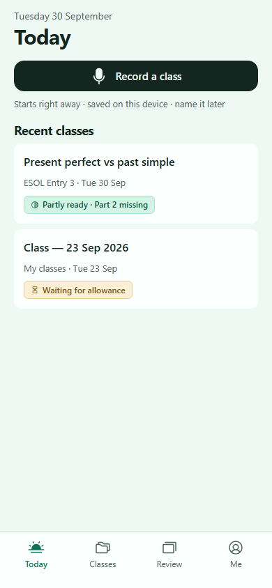 |
| پوسته، ۹۰۰ پیکسل (sidebar آیکونی) | 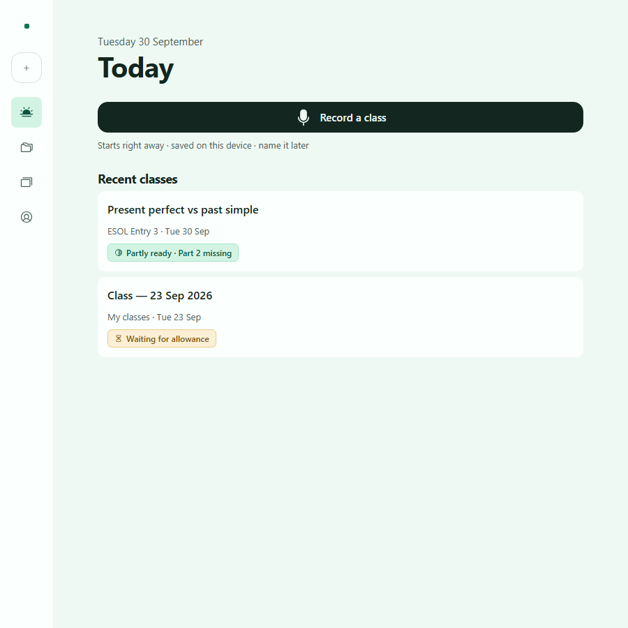 |
| پوسته، دسکتاپ (B1-desktop) | 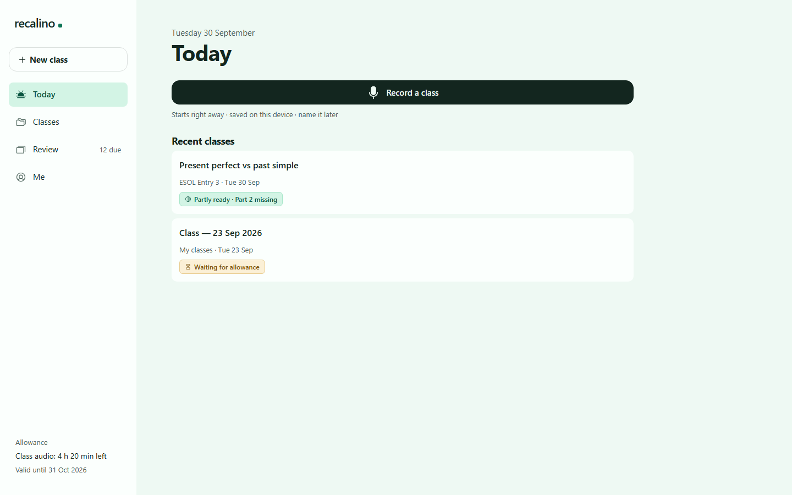 |
| پوسته، دسکتاپ، تیره | 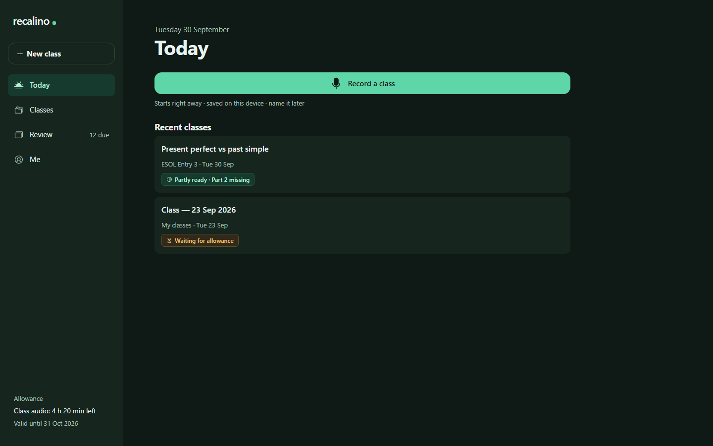 |
| دکمه‌ها | 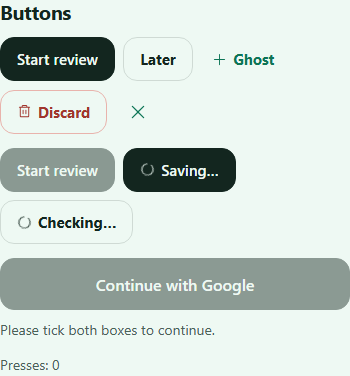 |
| فیلدها | 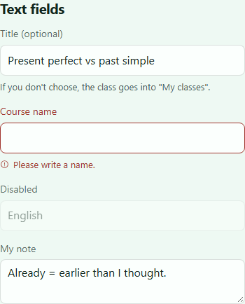 |
| انتخاب‌ها | 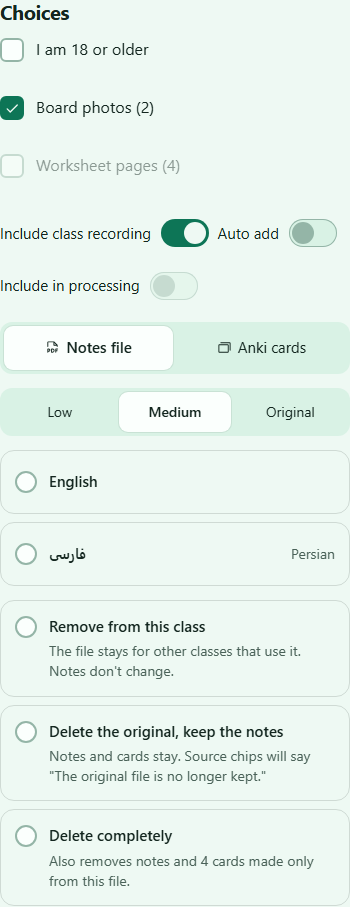 |
| وضعیت و منشأ | 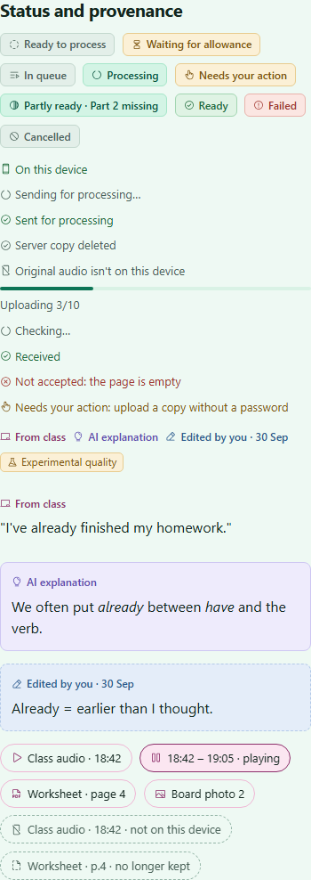 |
| وضعیت و منشأ، تیره | 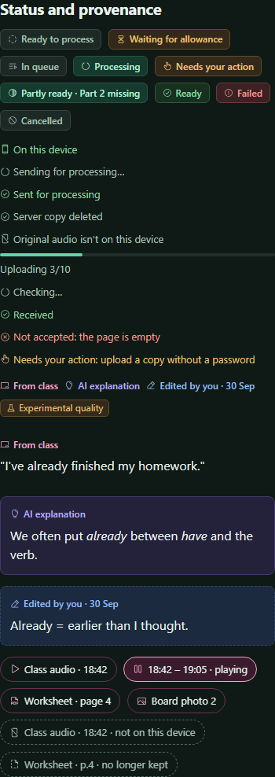 |
| بنرها و حالت‌ها | 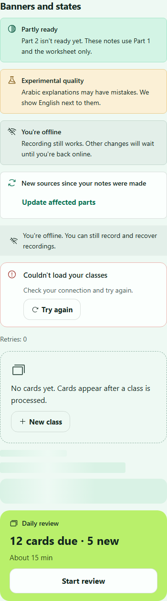 |
| خط‌ها و جهت متن | 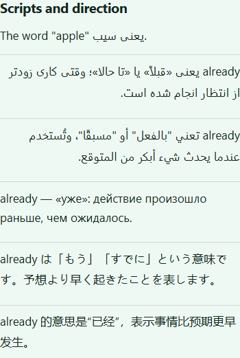 |
| Sheet موبایل (B2-sheet) | 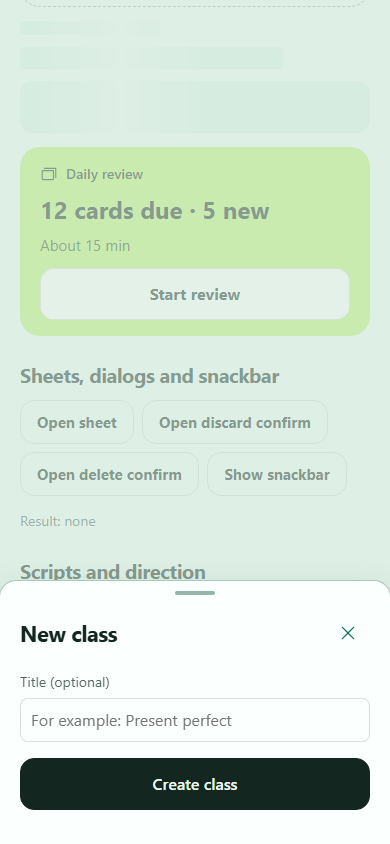 |
| Dialog دسکتاپ (B2-dialog) | 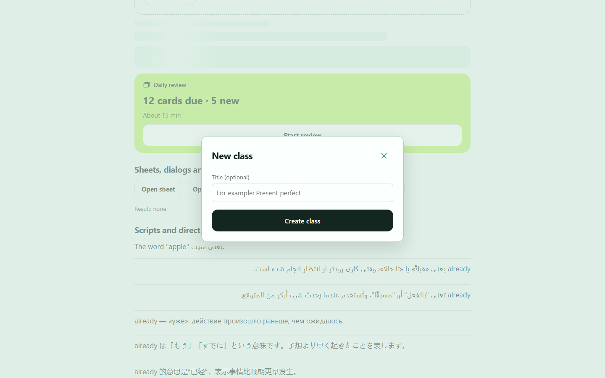 |
| تأیید حذف ضبط (C3-discard) | 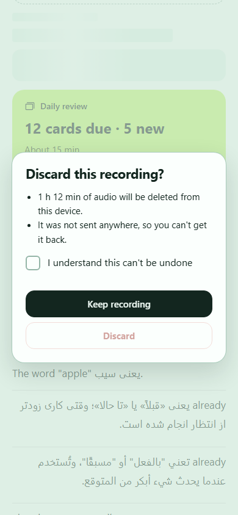 |

برای بازبینی دوباره: `pnpm dev` و صفحه‌های `/dev/ui` و `/dev/ui/shell`.

### تصمیم‌های پیاده‌سازی

- **CSS:** کامپوننت‌ها همان کلاس‌های طرح (`.btn`، `.input`، `.rc-hero` …) را به کار می‌برند. جزئیات هر کامپوننت در CSS Modules است، با مقادیر token یا قاب. Tailwind و کتابخانه UI اضافه نشد.
- **تم:** یک اسکریپت inline کوچک پیش از نمایش صفحه `data-theme` را تنظیم می‌کند. سرور `light` می‌فرستد، تا بدون JavaScript هم ظاهر طرح بماند.
- **آیکون:** نسخه SSR هر آیکون جداگانه import می‌شود. این نسخه به React context نیاز ندارد، پس در کامپوننت سرور و کلاینت یکسان کار می‌کند.
- **کامپوننت‌ها بدون `"use client"`:**
  - کامپوننت‌ها هر جا لازم باشد، در سرور یا کلاینت، رندر می‌شوند.
  - Sheet و Snackbar همیشه درون کامپوننت کلاینتِ صاحبشان‌اند.
  - Button وقتی در دسترس نیست هیچ handler نمی‌گیرد، پس در کامپوننت سرور هم کار می‌کند.
- **Sheet و Dialog:** عنصر بومی `<dialog>`، همراه یک حلقه کوچک focus و بازگرداندن focus. آزمون E2E یک باگ واقعی را گرفت: بستن پس از تأیید، به‌اشتباه گزینه امن را هم صدا می‌زد. اصلاح شد.
- **جهت متن:** `ContentBlock` جهت را از زبان بلوک می‌گیرد (`directionOf`). توضیح فارسی که با واژه انگلیسی شروع می‌شود («already یعنی …») با `dir="auto"` چپ‌به‌راست حدس زده می‌شد، ولی اکنون راست‌به‌چپ است.
- **یکدست‌سازی جاهایی که قاب‌ها با هم فرق دارند:** هر جا قاب‌ها اندازه‌های متفاوت داشتند، `components.md` و قاب صفحه‌ها مبنا شد:
  - Checkbox: ۲۴ پیکسل. قاب A1 ۲۲ پیکسل است.
  - Switch: ۴۸ × ۲۸. نمونه Design System ۴۴ × ۲۶ است.
  - RadioCard: اندازه‌های G3؛ بدون توضیح، مثل A2 وسط‌چین است.
  - Snackbar: تیره مطابق E3.
  - EmptyState: مطابق H-rules.
  - Sheet: مطابق B2.
- **حالت‌هایی که قاب ندارند:** فقط از الگوهای موجود ساخته شدند:
  - آیکون وضعیت‌های «Sending»، «Sent» و «Server copy deleted»
  - Sidebar آیکونی در ۷۶۸ تا ۱۰۲۳ پیکسل: عرض ۷۶ پیکسل (هدف ۴۴ به‌اضافه فاصله)، برچسب‌ها فقط برای صفحه‌خوان، بدون پانویس
  - ظاهر skip link: دکمه secondary
  - مدت چرخش spinner: سه برابر `--rc-dur-slow`
  - درخشش skeleton از رنگ‌های token
- **تفاوت تازه با طرح:** فقط متن skip link ([بازبینی تحویل](../design/HANDOFF_R1_REVIEW.md)، بند ۷).

### محدودیت‌ها و کارهای باقی‌مانده

- ~~**قابل نصب نیست** تا آیکون اپ از دور دوم طرح برسد ([APP_ICON_REQUEST.md](../design/APP_ICON_REQUEST.md)).~~ برطرف شد (2026-10-01): آیکون‌ها از دور دوم طرح رسیدند و در manifest و `layout.tsx` وصل شدند ([بازبینی تحویل](../design/HANDOFF_R1_REVIEW.md)، بخش دور دوم).
- **مقایسه تصویری خودکار نیست:** مقایسه با قاب‌ها با چشم و تصویر انجام شد. نمایش خط‌ها فقط با فونت‌های Windows دیده شد؛ ماتریس دستگاه‌ها با دروازه G04.
- **بستن sheet با کشیدن به پایین** ساخته نشد؛ Esc و ✕ کار می‌کنند.
- **Button در حالت loading عرضش را قفل نمی‌کند.** متن بارگذاری را صفحه می‌دهد.
- **CSP:** وقتی Content-Security-Policy اضافه شود، اسکریپت تم به hash یا nonce نیاز دارد.
- **Safari قدیمی:** رنگ پس‌زمینه پشت dialog (`::backdrop`) از متغیر CSS می‌آید و ممکن است در Safari قدیمی دیده نشود. dialog همچنان modal است.
- **پوسته هنوز به مسیرهای واقعی وصل نیست.** این کار با نخستین صفحه‌ها در M3 انجام می‌شود.
- **صفحه‌های `/dev`** در build تولیدی هستند، ولی بدون `RECALINO_DEV_UI=1` پاسخ 404 می‌دهند.
