# برنامه M3 — ورود با Google، ثبت‌نام و پروفایل یادگیری

> **وضعیت:** تأییدشده توسط مالک محصول (2026-10-01) — اجرا روی شاخه `feat/acc`؛ انجام شد، به‌جز T9 (2026-10-02). در انتظار تأیید ادغام.  
> **تاریخ:** 2026-10-01  
> **مبنا:** [FR ماژول ACC](../fr/ACC.md) · [FR-PLT-001](../fr/PLT.md) · [طرح، دور اول](../design/handoff-r1/HANDOFF.md) (A1، A2، B1-empty، G3) · [متن‌های حقوقی ۰٫۱](../legal/README.md) · [ADR-0001](../adr/0001-stack-and-hosting.md) · [ADR-0002](../adr/0002-data-access-and-migrations.md) · [گزارش M2](M2_UI_FOUNDATION.md)

## هدف

زبان‌آموز با حساب Google وارد می‌شود و دو اعلام را می‌پذیرد: ۱۸ سال یا بیشتر، و شرایط استفاده و اطلاعیه حریم خصوصی. سپس:

- پروفایل یادگیری را در هفت گام تنظیم می‌کند و به صفحه Today می‌رسد.
- پروفایل را بعداً در Settings تغییر می‌دهد و خارج می‌شود.
- هر صفحه و API غیرعمومی نشست معتبر را سمت سرور بررسی می‌کند.

ترتیب ساخت مرحله ۱ همین است: PLT، سپس ACC ([سند FR، بخش ۳.۲](../MVP_FUNCTIONAL_REQUIREMENTS_FA.md)).

## دامنه

| مورد | در M3 | توضیح |
|---|---|---|
| FR-PLT-001 نشست و مسیرهای محافظت‌شده | ✅ | |
| FR-ACC-001 ثبت‌نام با اعلام ۱۸+ و پذیرش شرایط | ✅ | صفحه A1 و برگه‌های متن حقوقی |
| FR-ACC-002 ورود و خروج | ✅ | یک صفحه برای ورود و ثبت‌نام، مطابق A1 |
| FR-ACC-003 تنظیم پروفایل | ✅ | گام‌های A2.1 تا A2.7، ذخیره پس از هر گام و ادامه از همان‌جا |
| FR-ACC-004 ویرایش پروفایل | ✅ | ردیف‌های Profile در Settings (G3)، با همان گام‌های A2 |
| FR-ACC-005 زبان توضیح و ترجیح‌های صریح | ✅ بخشی | زبان توضیح و مخزن ترجیح‌ها؛ صفحه ترجیح‌های آموخته‌شده (G2) با PERS در مرحله ۴ |
| FR-ACC-006 منطقه زمانی | ✅ | |
| FR-ACC-007 پذیرش نسخه تازه شرایط | ✅ | بنر و برگه مطابق G3، و تابعی که PROC بعداً برای بستن پردازش تازه صدا می‌زند |
| Today (B1-empty) | ⚠️ بخشی | فقط عنوان و متن حالت خالی. «Record a class» با REC (مرحله ۲) و «New class» با ORG (M4) می‌آیند. |
| SPIKE-05 (صف و ذخیره‌سازی) | ⏭ M4 | به ساخت Blob store در Vercel و دیتابیس ابری نیاز دارد، پس تأییدهای جداگانه می‌خواهد. |

## تصمیم‌های فنی

| مورد | انتخاب | دلیل |
|---|---|---|
| احراز هویت | Supabase Auth، فقط Google، با جریان PKCE از `@supabase/ssr`. همه کار Auth سمت سرور است و هیچ کلاینت Supabase در مرورگر ساخته نمی‌شود. | ADR-0001 و ADR-0002 (supabase-js فقط برای Auth) |
| cookie نشست | `httpOnly`، `secure` در production و `SameSite=Lax` | FR-PLT-001: توکن در دسترس اسکریپت صفحه نیست |
| بررسی نشست | در هر درخواست محافظت‌شده `getUser()`. این تابع خروج را بی‌درنگ می‌بیند. `proxy.ts` فقط توکن منقضی را تازه می‌کند. | معیار FR-PLT-001: توکن پس از خروج رد می‌شود |
| مسیر بازگشت | فقط مسیر نسبی داخل اپ؛ بقیه ← صفحه اصلی | FR-PLT-001 |
| گره زدن اعلام‌ها به ورود | فرم A1 روی سرور یک «نیت ثبت‌نام» یک‌بارمصرف و ده‌دقیقه‌ای می‌سازد، با شناسه تصادفی در cookie `httpOnly`. callback آن را در همان تراکنشی مصرف می‌کند که حساب را می‌سازد. | FR-ACC-001: اعلام‌ها قابل جعل یا انتقال نیستند |
| بازگشت از Google بدون اعلام | اگر حساب ریکالینو هست: ورود عادی. اگر نیست: حسابی ساخته نمی‌شود، ورود Supabase باطل و کاربر باقی‌مانده Auth حذف می‌شود. حذف با کلید secret است که فقط روی سرور است. | معیار FR-ACC-001؛ کمینه‌سازی داده |
| داده | schema به نام `acc` با این جدول‌ها: `user`، `signup_intent`، `consent` (فقط‌افزودنی، برای شرایط، حریم خصوصی و رضایت ضبط)، `learning_profile` همراه تاریخچه نسخه‌ها، و `preference` | ADR-0002؛ FR-ACC-004 (نسخه‌دار) |
| زبان توضیح | دو مقدار: `english` یا `first_language`. اگر زبان اول عوض شود، توضیح هم دنبالش می‌رود. | FR-ACC-003 و FR-ACC-005 |
| فهرست زبان‌ها | فهرست ISO 639-1 در یک فایل داده JSON؛ انگلیسی جزو زبان اول نیست؛ چینی دو گزینه دارد: ساده‌شده و سنتی. نام‌ها را مرورگر می‌سازد (`Intl.DisplayNames`). سطح کیفیت از `ACC_SETTINGS_JSON` می‌آید و تا آزمون EVAL همه زبان‌ها «Experimental» اند. | D31، قاعده ۲، ۳ و ۸ |
| انتخاب زبان و منطقه زمانی | یک combobox با الگوی ARIA 1.2، بدون کتابخانه headless | سبکی (D31، قاعده ۸)؛ HANDOFF ساختن از کامپوننت‌های موجود را مجاز می‌داند |
| متن‌های حقوقی در اپ | `docs/legal` منبع می‌ماند و یک اسکریپت ماژول اپ را از آن می‌سازد، با آزمون همگامی. نمایش با یک renderer کوچک برای همان بخشی از Markdown که متن‌ها دارند، فقط سمت سرور. `{{operator_email}}` از `PILOT_OPERATOR_EMAIL` پر می‌شود. `{{operator_name}}` از `PILOT_OPERATOR_NAME` می‌آید و تا تصمیم G11 در محیط توسعه با علامت ناتمام نمایش داده می‌شود. | Q-ACC-3؛ بدون بسته تازه |
| آزمون بدون Google | یک رابط Auth با دو پیاده‌سازی: Supabase و نسخه آزمون. E2E از یک مسیر آزمون وارد می‌شود که فقط با سرور Auth محلی کار می‌کند و هر نشانی دیگری را رد می‌کند. ورود واقعی با Google یک بار، دستی، روی محیط محلی بررسی می‌شود. | Google در CI در دسترس نیست |
| E2E در CI | job آزمون E2E هم Supabase محلی را راه می‌اندازد | صفحه‌های پس از ورود به Auth و دیتابیس نیاز دارند |

## کارها

همه کارها روی شاخه `feat/acc` انجام می‌شوند. پس از سبز شدن CI، pull request برای تأیید شما باز می‌شود.

- [x] **T1 — schema و migration ماژول ACC**
  - **پذیرش:**
    - migration، schema `acc` را با دسترسی فقط برای `recalino_app` می‌سازد.
    - نوع‌های Kysely تولید می‌شوند و مرز ماژول‌ها رعایت می‌شود.
  - **بررسی:** `pnpm db:reset && pnpm db:types && pnpm verify`
- [x] **T2 — نشست (FR-PLT-001)**
  - **پذیرش:**
    - کلاینت سرور Supabase و `proxy.ts` ساخته می‌شوند.
    - `SessionProvider` مسیرهای API همان نشست را بررسی می‌کند.
    - صفحه‌های محافظت‌شده بدون نشست به A1 می‌روند و مسیر بازگشت حفظ می‌شود.
    - خروج نشست را سمت سرور باطل می‌کند.
    - همه معیارهای پذیرش FR-PLT-001 برآورده می‌شوند، به‌جز معیار ضبط که با REC در مرحله ۲ آزموده می‌شود.
  - **بررسی:** آزمون یکپارچه روی Auth محلی، از جمله رد توکن پس از خروج
- [x] **T3 — A1 و callback (FR-ACC-001، FR-ACC-002)**
  - **پذیرش:**
    - دو اعلام از پیش تیک‌نخورده‌اند و تا تیک خوردن هر دو، دکمه ادامه در دسترس نیست.
    - برگه‌های متن حقوقی باز می‌شوند و تیک‌ها از دست نمی‌روند.
    - نیت ثبت‌نام یک‌بارمصرف است. callback بدون اعلام حساب نمی‌سازد و ثبت‌نام دوباره حساب دوم نمی‌سازد.
    - پیام خطا کلی است و وجود حساب را افشا نمی‌کند.
    - کنترل نرخ و رخداد امنیتی طبق FR-PLT-006 و FR-PLT-007 اعمال می‌شوند.
  - **بررسی:** آزمون یکپارچه callback، از جمله دو callback هم‌زمان؛ E2E صفحه A1 تا هدایت به Google
- [x] **T4 — تنظیم پروفایل A2 (FR-ACC-003، FR-ACC-005، FR-ACC-006)**
  - **پذیرش:**
    - هفت گام مطابق قاب‌ها، با ذخیره پس از هر گام و ادامه از همان گام.
    - زبان آزمایشی برچسب و جمله توضیح دارد.
    - زبان توضیح پیش‌فرض ندارد. سطح و هدف اختیاری‌اند.
    - منطقه زمانی از مرورگر پیشنهاد می‌شود.
    - رضایت ضبط با نسخه و زمان ثبت می‌شود و تا تیک نخورده، تنظیم تمام نمی‌شود.
    - همه معیارهای پذیرش FR-ACC-003 برآورده می‌شوند.
  - **بررسی:** آزمون واحد و یکپارچه؛ E2E کل مسیر تنظیم با صفحه‌کلید و axe
- [x] **T5 — Today و هدایت پس از ورود**
  - **پذیرش:**
    - تنظیم ناتمام ← A2 در همان گام. تنظیم کامل ← Today با حالت خالی B1.
    - نوار ناوبری فقط به صفحه‌هایی می‌رود که ساخته شده‌اند.
  - **بررسی:** E2E
- [x] **T6 — Settings (FR-ACC-004، FR-ACC-006، خروج)**
  - **پذیرش:**
    - ردیف‌های Profile در G3 هر کدام همان گام A2 را برای ویرایش باز می‌کنند.
    - تغییر نسخه تازه پروفایل می‌سازد و ذخیره دوباره همان مقادیر نسخه نمی‌سازد.
    - پیام «تغییر فقط بر تولیدهای بعدی اثر دارد» نمایش داده می‌شود.
    - دکمه Sign out در پایین Settings هست (تفاوت تازه با طرح، بند ۸).
  - **بررسی:** آزمون یکپارچه و E2E
- [x] **T7 — نسخه تازه شرایط و رضایت ضبط (FR-ACC-007، D33 قاعده ۳)**
  - **پذیرش:**
    - پس از تغییر نسخه شرایط یا اطلاعیه، بنر و برگه G3 نمایش داده می‌شوند و پذیرش با نسخه و زمان ثبت می‌شود.
    - تابع «اجازه پردازش تازه» تا پذیرش `false` برمی‌گرداند.
    - نسخه تازه رضایت ضبط یک بار نمایش داده می‌شود.
  - **بررسی:** آزمون یکپارچه و E2E
- [x] **T8 — آزمون بین‌حسابی، E2E و CI**
  - **پذیرش:**
    - هر مسیر API تازه آزمون بین‌حسابی دارد (NFR-01).
    - job آزمون E2E، Supabase محلی را راه می‌اندازد.
    - axe روی همه صفحه‌های تازه در دو تم بدون تخلف است.
    - بودجه حجم برای صفحه A1 هم ثبت می‌شود.
  - **بررسی:** CI سبز
- [ ] **T9 — بررسی دستی ورود واقعی با Google**
  - **پذیرش:** پس از ساخت OAuth Client توسط شما ([راهنما](../runbooks/GOOGLE_OAUTH.md))، یک ورود کامل با حساب خودتان روی محیط محلی انجام و در گزارش ثبت می‌شود.
  - **بررسی:** دستی
- [x] **T10 — گزارش M3**
  - **پذیرش:** معیارها همراه شواهد و تصویرهای مقایسه با قاب‌ها؛ ماتریس ردیابی به‌روز؛ محدودیت‌ها ثبت می‌شوند.
  - **بررسی:** clone تازه، `pnpm verify` و `pnpm test:e2e`؛ CI سبز

## ریسک‌ها

| ریسک | کاهش |
|---|---|
| Google در CI در دسترس نیست | رابط Auth با نسخه آزمون، و یک بررسی دستی ثبت‌شده با Google واقعی (T9) |
| مسیر آزمون ورود به محیط واقعی نشت کند | این مسیر نشانی سرور Auth را بررسی می‌کند و جز `127.0.0.1` یا `localhost` را رد می‌کند؛ در production هم 404 است |
| `getUser()` در هر درخواست یک رفت‌وبرگشت شبکه است | Vercel و Supabase هر دو در لندن‌اند. اگر در پایلوت کند بود، اندازه‌گیری و بازبینی می‌شود. |
| نام زبان‌ها در مرورگرهای مختلف کمی فرق کند | فهرست فقط در مرورگر ساخته می‌شود و جست‌وجو هم با نام انگلیسی و هم با نام بومی کار می‌کند |
| متن‌های حقوقی پیش‌نویس‌اند | در اپ برچسب Draft دارند؛ نسخه ۱٫۰ پیش از پایلوت (G11) |

## تأییدهای مالک محصول (2026-10-01)

1. این برنامه تأیید شد، همراه انتقال SPIKE-05 به M4.
2. افزودن `@supabase/supabase-js` و `@supabase/ssr` تأیید شد.
3. **ورود فقط برای دعوت‌شده‌ها:** وضعیت Testing در Google Auth Platform، با فهرست test users که مالک محصول در Google Cloud نگه می‌دارد. اپ کد allowlist ندارد.
4. **دکمه Sign out در پایین Settings** است ([بازبینی تحویل](../design/HANDOFF_R1_REVIEW.md)، بند ۸).

## کار شما

ساخت OAuth Client در Google Cloud، طبق [راهنمای گام‌به‌گام](../runbooks/GOOGLE_OAUTH.md). هر وقت در طول M3 فرصت داشتید انجامش دهید. بقیه کار منتظر آن نمی‌ماند؛ فقط T9 به آن نیاز دارد.

## پس از M3

- **M4:** SPIKE-05 (صف Postgres از طریق pooler، Blob و یکپارچه‌سازی قطعه‌ها) و FR-PLT-005، FR-PLT-008 و FR-PLT-014.
- **پس از آن:** QUOTA و ORG، سپس SRC، طبق ترتیب ساخت.

## گزارش M3 (2026-10-02)

### نتیجه

| کار | پیاده‌سازی | آزمون |
|---|---|---|
| T1 schema | `supabase/migrations/20261001200000_acc_core.sql` (schema `acc`)، `packages/core/src/db/types.ts` | `acc/*.int.test.ts` |
| T2 نشست | `apps/web/src/proxy.ts`، `server/auth/` (`supabase.ts`، `gateway.ts`، `learner.ts`، `return-path.ts`)، `server/api.ts` | `auth/flow.int.test.ts`، `auth/return-path.test.ts`، `cross-account/`، `e2e/account.spec.ts` |
| T3 A1 و callback | `app/page.tsx`، `app/SignIn.tsx`، `app/SignInForm.tsx`، `server/auth/flow.ts`، `packages/core/src/acc/signup.ts` | `acc/signup.int.test.ts`، `auth/flow.int.test.ts`، `e2e/signin.spec.ts` |
| T4 تنظیم پروفایل | `app/setup/`، `acc/profile.ts`، `acc/languages.ts`، `ui/components/ListPicker.tsx` | `acc/acc.test.ts`، `acc/profile.int.test.ts`، `app/setup/languages.test.ts`، `e2e/setup.spec.ts` |
| T5 Today و هدایت | `app/(app)/`، `server/auth/learner.ts` (`requireLearner`) | `e2e/setup.spec.ts`، `e2e/account.spec.ts` |
| T6 Settings | `app/(app)/me/`، `server/account-routes.ts` (`PATCH /api/profile`) | `cross-account/profile.int.test.ts`، `e2e/account.spec.ts` |
| T7 نسخه تازه متن‌ها | `acc/account.ts` (`acceptDocuments`، `canStartNewProcessing`)، `app/(app)/TermsNotice.tsx`، `app/setup/consent/`، `POST /api/consents` | `acc/profile.int.test.ts`، `cross-account/consents.int.test.ts`، `e2e/account.spec.ts` |
| T8 CI | `.github/workflows/ci.yml` (Supabase محلی در job آزمون E2E) | همه آزمون‌ها |
| متن‌های حقوقی در اپ | `tools/legal/build.ts` ← `apps/web/src/legal/texts.generated.ts`، `ui/markdown.ts`، `ui/components/LegalDocument.tsx` | `tools/legal/build.test.ts`، `ui/markdown.test.ts` |

- **آزمون‌ها:**
  - ۲۱۵ آزمون واحد و ۵۴ آزمون یکپارچه؛ `pnpm verify` سبز است.
  - ۶۹ آزمون E2E (۳۶ تازه) روی build تولیدی، مثل CI، سبزند.
  - هر مسیر API تازه آزمون بین‌حسابی دارد: `PATCH /api/profile`، `POST /api/consents` و `POST /auth/sign-out` (NFR-01).
- **امنیت نشست (FR-PLT-001):**
  - cookie پس از خروج در مرورگر دیگری بازپخش شد و رد شد.
  - callback با code جعلی یا تکراری رد و به‌عنوان رخداد امنیتی ثبت می‌شود.
  - مسیر بازگشت به سایت دیگر نمی‌رود.
- **اسرار:** `pnpm check:client-bundle` هیچ سری در خروجی مرورگر پیدا نکرد. `SUPABASE_SECRET_KEY` فقط روی سرور است.
- **دسترس‌پذیری:** axe هیچ تخلف WCAG 2.2 AA پیدا نکرد:
  - A1، و صفحه‌های Today، Classes، Review، Settings و ویرایش پروفایل، هر کدام در دو تم و در ۳۹۰ و ۱۴۴۰ پیکسل
  - هر پنج صفحه تنظیم پروفایل
  - گام زبان اول در آزمون با صفحه‌کلید انتخاب می‌شود.
- **حجم صفحه** (build تولیدی، بایت فشرده منتقل‌شده):

  | صفحه | JS | CSS | سقف JS / CSS |
  |---|---|---|---|
  | `/` (A1) | ۱۴۷ KB | ۹٫۹ KB | ۱۶۰ / ۱۲ KB |
  | `/dev/ui` | ۱۶۸ KB | ۹٫۹ KB | ۱۹۰ / ۱۲ KB |
  | Today، Classes، Review، Settings | ۱۴۸ KB | ۹٫۹ KB | — |
  | `/setup` | ۱۵۵ KB | ۹٫۹ KB | — |
  | ویرایش زبان اول | ۱۵۸ KB | ۹٫۹ KB | — |

  نخستین اندازه‌گیری A1 از سقف رد شد (۱۷۰ KB)، چون کل صفحه کامپوننت کلاینت بود. اکنون صفحه در سرور ساخته می‌شود و فقط فرم و برگه‌ها در مرورگر اجرا می‌شوند.

### مقایسه با طرح

هر صفحه کنار قاب خودش در ۳۹۰ و ۱۴۴۰ پیکسل بررسی شد. تصویرها از build تولیدی، Chromium روی Windows:

| | تصویر |
|---|---|
| A1، موبایل | 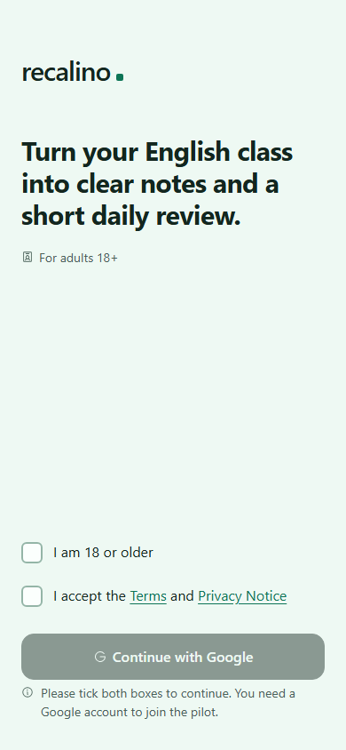 |
| A1، دسکتاپ (A1-desktop) | 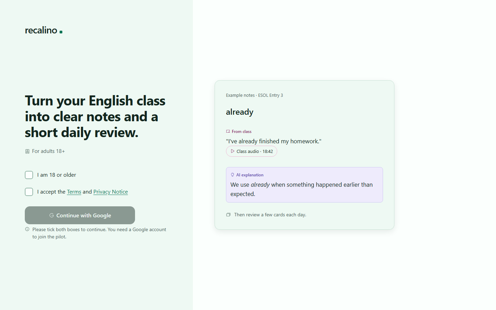 |
| A1، ورود ناموفق (A1-failed) | 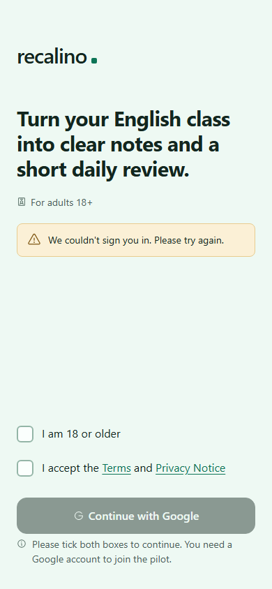 |
| A2.1، زبان آزمایشی (A2-1b) | 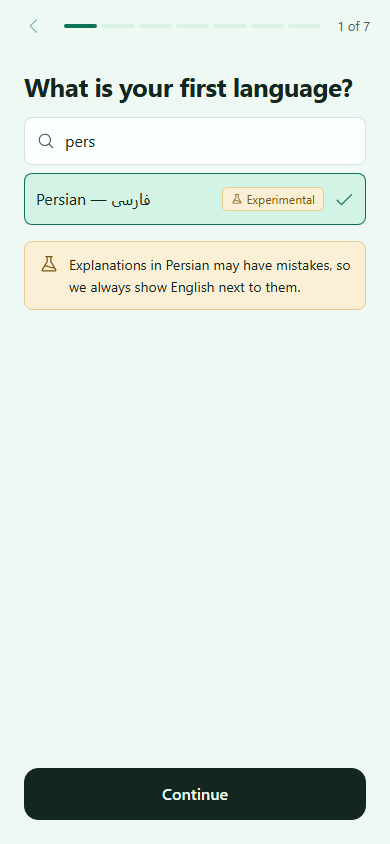 |
| A2.3، زبان توضیح | 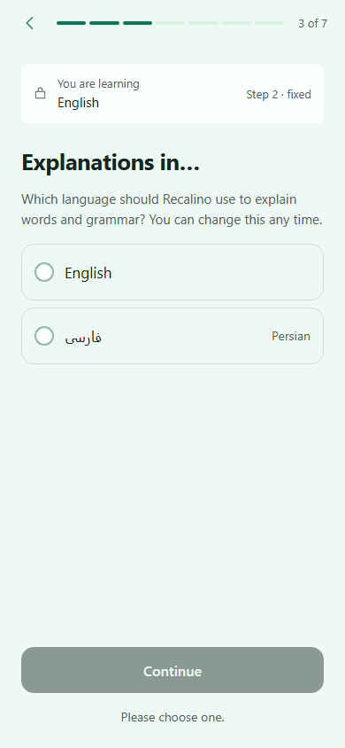 |
| A2.4–5، سطح و هدف | 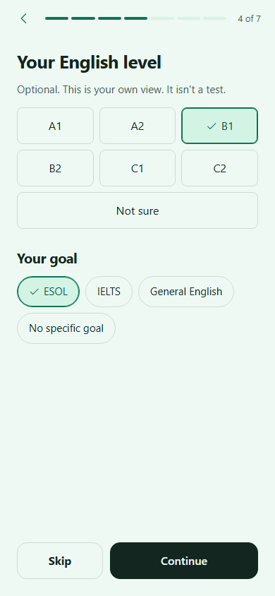 |
| A2.6، منطقه زمانی | 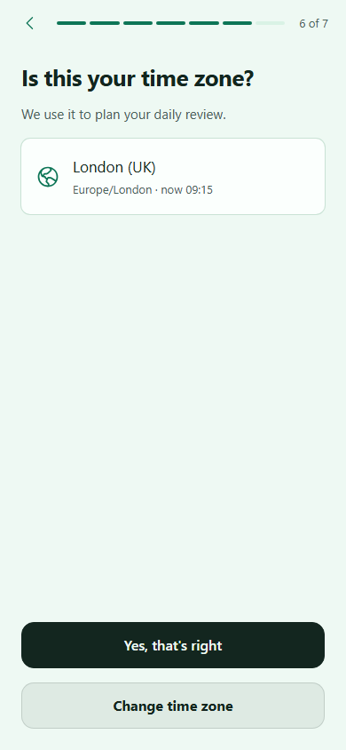 |
| A2.7، رضایت ضبط | 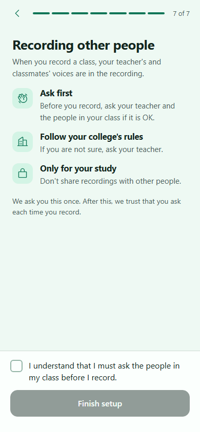 |
| B1، حالت خالی | 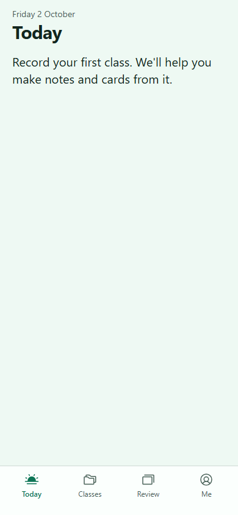 |
| B1، دسکتاپ | 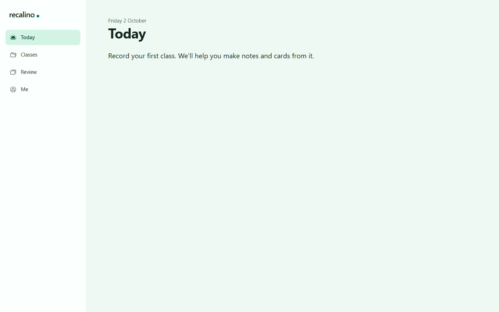 |
| G3، Settings | 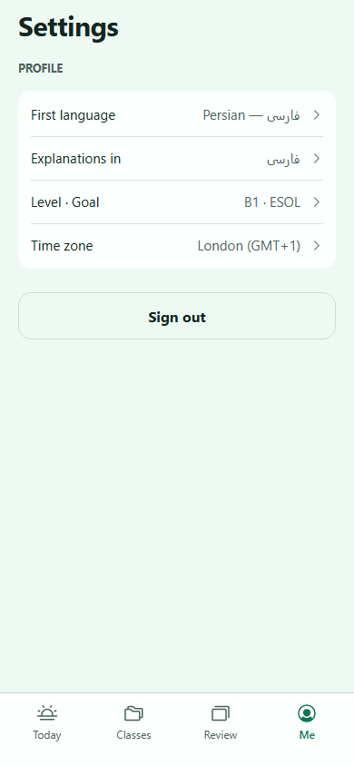 |
| G3، دسکتاپ | 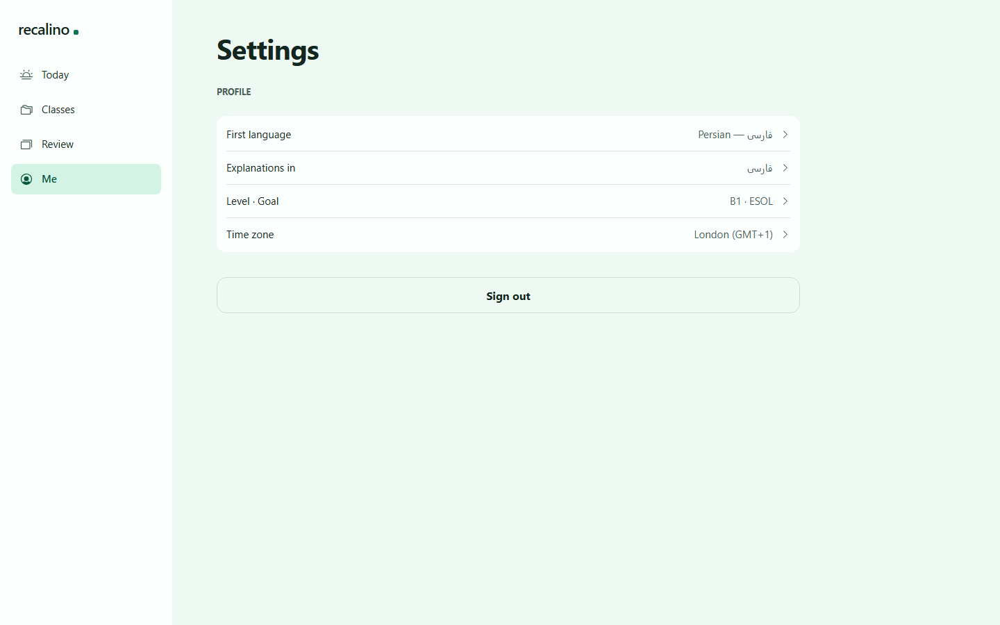 |
| G3، بنر نسخه تازه Terms | 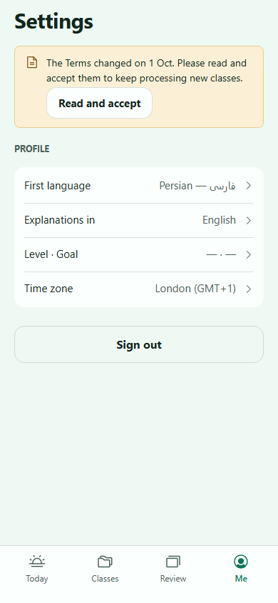 |
| رضایت ضبط، نسخه تازه | 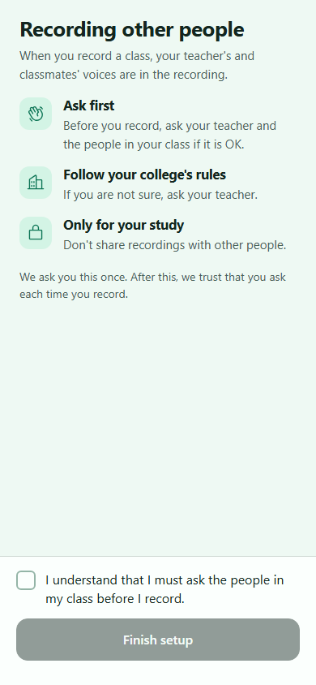 |

برای بازبینی دوباره: `pnpm db:start`، `pnpm db:env`، `pnpm dev`. ورود آزمایشی فقط با Auth محلی: `POST /dev/auth/session` (`e2e/learner.ts`).

### تصمیم‌های پیاده‌سازی

- **همه کار Auth روی سرور:**
  - مرورگر کلاینت Supabase ندارد.
  - `proxy.ts` فقط توکن را تازه می‌کند.
  - هر صفحه و API محافظت‌شده نشست را با `getUser()` بررسی می‌کند.
- **اعلام‌ها:** «نیت ثبت‌نام» در همان تراکنشی مصرف می‌شود که حساب را می‌سازد. دو callback هم‌زمان یک حساب می‌سازند.
- **ورود آزمایشی:** مسیر `/dev/auth/session` فقط با `RECALINO_DEV_UI=1` و Auth روی `127.0.0.1` یا `localhost` کار می‌کند. در production پاسخ 404 است.
- **پذیرش متن‌ها:** حساب وقتی «در انتظار پذیرش» است که نسخه فعلی هر متن را هرگز نپذیرفته باشد. نسخه قدیمی‌تر از فعلی رد می‌شود.
- **متن‌های حقوقی:** از `docs/legal` با `pnpm legal:build` ساخته می‌شوند و آزمونی ناهمخوانی را می‌گیرد. بخش کوچکی از Markdown به‌صورت متن React نمایش داده می‌شود، بدون HTML. نشانی و نام اپراتور از پیکربندی سرور می‌آیند.
- **نام زبان‌ها و کشور منطقه زمانی** از داده Intl خود مرورگر می‌آیند (D31 قاعده ۸)؛ هیچ داده زبانی به bundle اضافه نشد.
- **بنر نسخه تازه Terms** در همه صفحه‌های واردشده، زیر عنوان صفحه است؛ مثل G3.
- **دکمه در دسترس‌نبودن:** با ۴۵٪ شفافیت و دلیل، طبق `components.md`. قاب‌ها حالت عادی دکمه را نشان می‌دهند.
- **متن A1:** متن دو اعلام از `copy.md` است («I am 18 or older»، «I accept the Terms and Privacy Notice»). قاب نقطه پایانی و «the» دارد؛ `copy.md` مقدم است.
- **گزینه یک‌خطی RadioCards** مثل قاب A2.3 با وزن عادی و ۱۷ پیکسل است. گزینه‌های توضیح‌دار G3 تغییری نکردند.
- **تفاوت تازه با طرح:** بند ۸ (Sign out) و بند ۹ (کشور در کارت منطقه زمانی؛ [بازبینی تحویل](../design/HANDOFF_R1_REVIEW.md)).

### محدودیت‌ها و کارهای باقی‌مانده

- **T9، ورود واقعی با Google،** منتظر ساخت OAuth Client است ([راهنما](../runbooks/GOOGLE_OAUTH.md)). همه آزمون‌ها با Auth محلی‌اند و Google در آن‌ها صدا زده نمی‌شود.
- **کنترل نرخ ورود در کلاس:** سقف فعلی ۱۰ تلاش در ۱۰ دقیقه برای هر IP است. اگر همه کلاس هم‌زمان از اینترنت کالج ثبت‌نام کنند، از یک IP می‌آیند و بیشترشان رد می‌شوند. سقف با `PLT_SETTINGS_JSON` تغییر می‌کند؛ تصمیمش با مالک محصول است.
- **تب Me فعلاً مستقیم Settings است.** صفحه G1 (Progress) به داده مرور نیاز دارد و با SRS می‌آید. تا آن زمان پیکان بازگشت G3 نیست. بخش‌های Review و Data در G3 هم با SRS و PRIV می‌آیند.
- **Today فقط متن حالت خالی را دارد.** آیکون میکروفون و «Record a class» با REC (مرحله ۲) و «New class without recording» با ORG (M4) می‌آیند. تا آن زمان متن زیر عنوان است، نه وسط صفحه.
- **دکمه پاک کردن جست‌وجو (⊗)** که در قاب A2.1 هست ساخته نشد، چون برچسب صفحه‌خوان آن در `copy.md` نیست.
- **Firefox** داده کشور منطقه زمانی را ندارد؛ آنجا کارت فقط نام شهر را نشان می‌دهد.
- **پاک‌سازی نیت‌های ثبت‌نام منقضی:** تابعش (`purgeExpiredSignupIntents`) آماده است، ولی کار زمان‌بندی‌شده با صف کارها (FR-PLT-005، M4) وصل می‌شود.
- **متن‌های حقوقی پیش‌نویس ۰٫۱اند.** نام اپراتور تا G11 با علامت ⟨…⟩ نمایش داده می‌شود.
- **محیط ابری:** چیزی مستقر نشده است. تنظیم Auth در Supabase ابری (Google و نشانی‌های بازگشت) و متغیرهای Vercel با milestone استقرار و تأیید جداگانه انجام می‌شود.
- **سقف حجم** فقط برای `/` و `/dev/ui` در CI بررسی می‌شود؛ صفحه‌های واردشده یک بار دستی اندازه‌گیری شدند.
